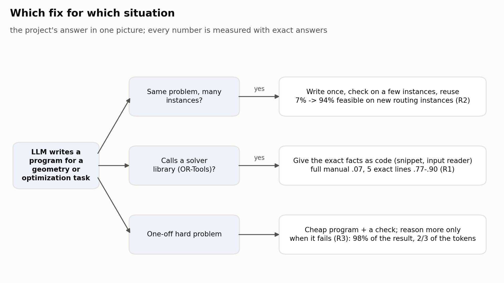
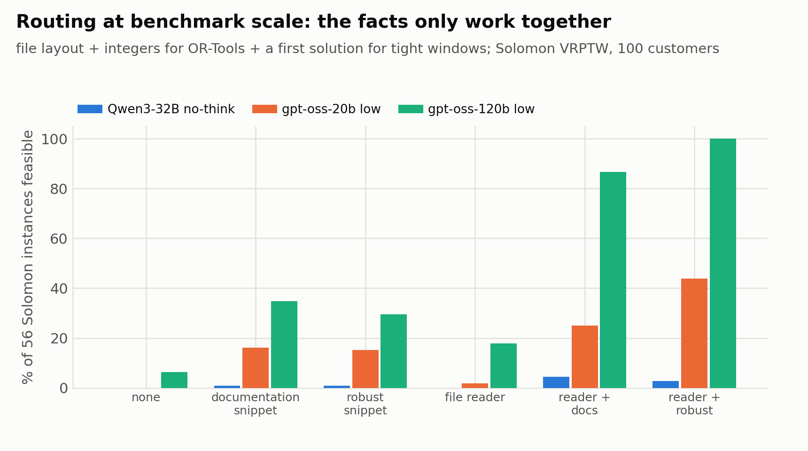
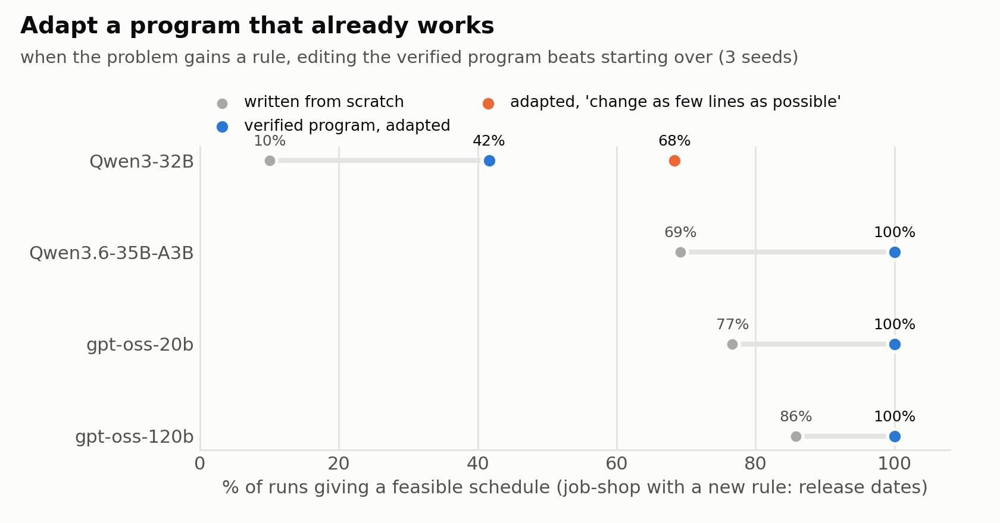
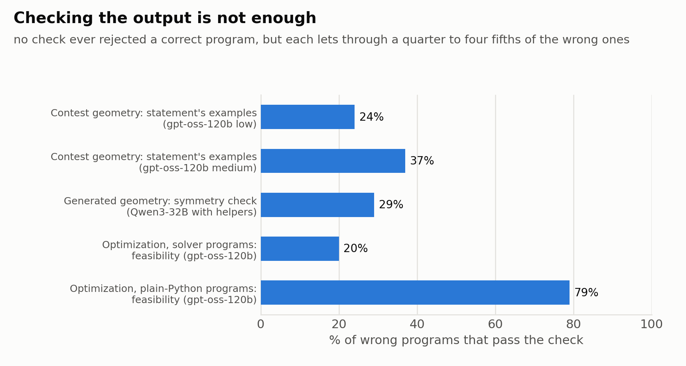
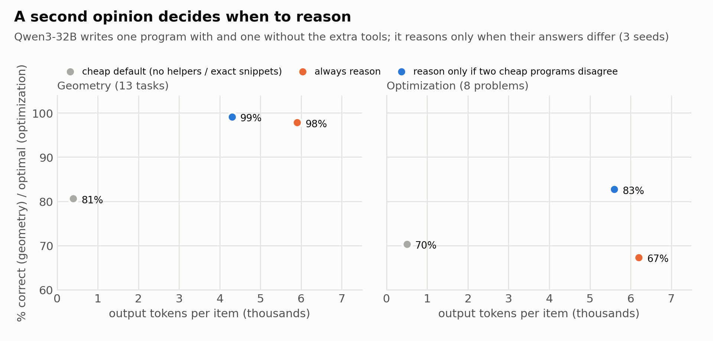
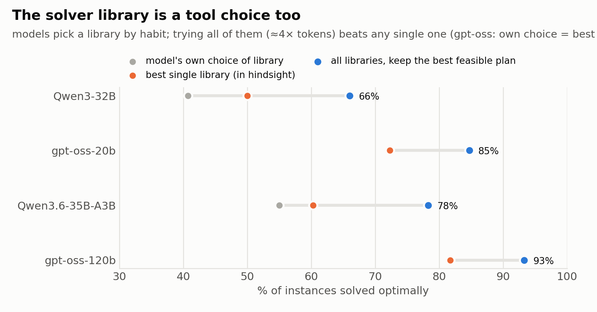

# Tools, Facts, and Checks: When LLM-Written Geometry and Optimization Code Fails, and Which Fix to Use

*Graduate NLP course project proposal*

> **About this file.** The project proposal in short. Full log of every run and correction: [docs/FINDINGS.md](docs/FINDINGS.md); failure → fix map: [docs/notes/FIX_MAP.md](docs/notes/FIX_MAP.md); how much cheap checks miss: [docs/notes/CHECKS.md](docs/notes/CHECKS.md); earlier long versions: `results/archive/`.

## 0. Background: how LLMs solve geometry and optimization problems

**The problems.**
- **Computational geometry:** compute an exact answer from coordinates, such as the area of a polygon or the convex hull of a set of points.
- **Combinatorial optimization:** pick the best of very many options, such as the shortest delivery routes. Checking that an answer is valid is easy; proving it is the best is hard.

**Six ways an LLM can solve them:**

| Approach | How it works | Example | Known from |
|---|---|---|---|
| 1. Answer directly | the model works the answer out in text | "Twice the area is 436." | chain-of-thought; reasoning models |
| 2. Improve guesses | the model proposes solutions, sees their scores, proposes better ones | "Tour 1-3-2-4 has length 120; give a shorter tour." | OPRO |
| 3. Write a program | the model writes code; the computer runs it | `print(abs(sum(x1*y2 - x2*y1 ...)))` (shoelace area) | PAL, AlphaCode |
| 4. Use a solver | the model writes the problem as solver code; the solver finds the best answer | `m.Add(c[a] != c[b])` for each edge, then `m.Minimize(k)` (graph colouring) | OptiMUS, ORLM |
| 5. Evolve a heuristic | many versions of a rule are tested; the best survive | evolve `priority(item, bins)`: which bin gets the next item | FunSearch, EoH |
| 6. Help a prover | the model suggests steps; a symbolic engine proves geometry theorems | "add the midpoint of AB", then the engine finishes the proof | AlphaGeometry |

In practice geometry is solved with approach 3 and optimization with 3 and 4. Direct answers fail: asked for twice the area of one polygon in 8 equivalent copies (shifted, rotated, mirrored, …), Qwen3-8B says 436 (correct), 2944, 392 and 728; the program it writes is right on all 8.

## 1. Why this matters

1. **This code runs in real systems, and its errors are silent.** Coding assistants and agents write route planners, schedulers and geometry routines (maps, CAD, robots). A wrong program still runs and prints an answer: a hull that is wrong only on the mirrored input, a delivery that arrives just after the customer's time window closes because of a rounding error.
2. **"Give the model more" is the default, and it can backfire.** Agents get large tool catalogs and documentation dumps. On vehicle routing, the full OR-Tools manual makes Qwen3-32B *worse* than no documentation (.07 vs .23 solved optimally); 5 exact lines make it right (.77–.90).
3. **Tokens are the main cost of using LLMs.** On 311 real contest geometry problems, gpt-oss-120b solves 57% at medium effort (6.8k tokens per problem) and 66% at high effort (30k): 4.4× the cost for 9 more points.

**Goal:** a practical map from *what went wrong* to *the cheapest fix that works*, measured with exact answers on standard benchmarks. In one picture:

## 2. Question and how we test

**Question:** what should go into the prompt, and which cheap fix works for which failure, at what token cost? (1) Tools: can unneeded helpers hurt? (2) Facts: a full manual, or one exact usage example? (3) Fixes: check, repair, reuse, or pay for reasoning?

- **Strict scoring:** geometry programs must be right on 8 equivalent copies of each input; routing and scheduling plans must be feasible and close to the best known.
- **One change at a time**, compared with the same prompt without it; predictions written before every run; 2–3 seeds per condition; accuracy always reported with its token cost; programs read, not only scores. Rewording the contest prompt moves accuracy by under 2 points, within seed noise.
- **Models:** open models run locally: Qwen3 (1.7B–32B), Qwen3.8-27B, Qwen3.6-35B-A3B, Llama 3, gpt-oss-20b / 120b.

**Benchmarks, each with an example:**

| Benchmark | Size | Example instance | Solved when |
|---|---|---|---|
| Codeforces geometry (CodeContests) | 311 problems, rated 800–3500 | *Triangles on a Rectangle* (rated 1000): lattice points lie on the sides of a w × h rectangle; choose 3, exactly two on one side, to maximise the triangle's doubled area. Input `5 8` / `2 1 2` / `3 2 3 4` / `3 1 4 6` / `2 4 5` → `25`. Hard end: *Chris and Road* (2100): when can a pedestrian cross while a convex-polygon bus drives by? | all official tests pass |
| Solomon vehicle routing with time windows | 56 instances, 100 customers | `c101`: 25 trucks of capacity 200; customer 1 at (45, 68) needs 10 units, may be served only between times 912 and 967, and service takes 90 | every customer served once, loads and time windows respected; distance vs the best known |
| Job-shop scheduling (OR-Library) | la01–la40 (10 × 5 to 30 × 10) + 42 larger (up to 50 × 10) | `la01`, job 1: machine 1 for 21, then machine 0 for 53, machine 4 for 95, machine 3 for 55, machine 2 for 34 | a valid schedule; length vs a 120 s CP-SAT run |
| Generated geometry (13 tasks) | 60 instances per task, each as 8 copies | "How many vertices does the convex hull of (20,−40) (−26,−18) … have?"; also polygon area, lattice points in a polygon, Delaunay check, polygon clipping | right on all 8 copies |
| Generated optimization (8 problems) | 6 instances per size | knapsack with 40 items, TSP with 20 cities, CVRP with 8 customers, colouring a 40-node graph | the proven optimum |

## 3. Main results on real benchmarks

**R1. Solver code fails for missing facts, not missing intelligence.**
> *Example* (Qwen3-32B, OR-Tools routing). Given the full manual, it invents a method: `routing.RegisterUnaryLongLivingCallback(...)` → `AttributeError`. Given 5 lines with the right call, `RegisterUnaryTransitCallback`, it reaches the proven optimum.

On the 56 Solomon instances three facts are needed together: the file layout, "OR-Tools takes integers everywhere" (models write `1e7`), and a start strategy for tight time windows. Without them at most 6% of programs give a feasible plan at low effort; with them gpt-oss-120b reaches 100%. Reasoning cannot replace them (.03 without documentation), and a needed helper with a hidden flaw is a trap: a travel-time helper that rounds instead of rounding up drops feasibility from 95% to 69%.

**R2. Write once, verify, reuse; when the problem changes, adapt the verified program.**
> *Example* (gpt-oss-120b, routing). Draw 16 programs, keep one that gives feasible plans on 8 training instances, run it unchanged on 48 new ones: 94% feasible, against 7% when writing a new program per instance, for 28k tokens in total.

The reused programs stay feasible on 200- and 400-customer instances (60 of 60 each) and on 42 larger job-shop instances (within 4.3% of a 120 s CP-SAT run). When the problem gains a rule (job-shop + release dates), editing the verified program beats starting over for every model; for Qwen3-32B, adding "change as few lines as possible" lifts it from 10% to 68%. Editing can hurt when the new rule changes the model's structure (flexible job-shop, gpt-oss-120b). Benchmarks that score a fresh program per instance therefore understate these models.

**R3. Checks never reject a correct program but miss many wrong ones; pay for reasoning only when a check fails.**
> *Example* (contest geometry). A program can print the right answer on the statement's 2 examples and still be wrong on the hidden tests: 24–37% of gpt-oss-120b's wrong programs pass the examples.

So use the check to decide when to spend: escalate from medium to high effort only when the examples fail, or when a brute-force program on small inputs disagrees. This keeps the high-effort accuracy (66.3% vs 66.2%) at 82% of its tokens; one repair round is the best first step per token.

A *second opinion* works when its mistakes are independent: Qwen3-32B writes one program with and one without the extra tools and reasons only when they disagree. That matches always reasoning in geometry (99% vs 98%) at 61–79% of the tokens, and beats it in optimization (83% vs 67%); the same holds for Qwen3-8B. It fails for gpt-oss-120b on contest problems, where both programs share the same mistakes.

**R4. Choose the fix by problem type, not by the error message.** For Qwen3-32B, picking the fix from the first failure's error message is no better than the best single fix (geometry 88.9 vs 89.8%, optimization 73.0 vs 76.0%), and letting the model pick is worse (85.2 / 69.0%). Simple defaults win: in geometry, drop unneeded tools or reason; in optimization, give exact snippets (Qwen3.6: 91% vs 64% with the full manual). The solver library is a tool choice too: models pick one by habit, the best one differs by model and problem, and trying all of them per instance (keep the best feasible plan) beats any single library for every model, at ≈4× tokens; trying another library only when the plan is infeasible keeps 96–98% of its accuracy at 34–84% of the tokens.

## 4. Mechanisms on generated tasks (why the fixes work)

- **M1. Unneeded helpers change the algorithm.** *Example* (Qwen3-8B, hull): with 8 unneeded helpers it builds on the offered `polar_sort(points, left)` and is wrong on all 8 copies (97% → 8% with two such helpers); a one-sentence hint fixes it at 0.6k tokens (94%), reasoning at ≈6k. On real contest problems the effect is small (−4 points, gpt-oss-20b only), and it is invisible in the model's token confidence.
- **M2. A needed tool with a hidden condition is a trap.** *Example* (Qwen3-32B, lattice points): the helper returns a *signed* area and the model forgets `abs()`: 9–15 of 60 correct instead of 44; fixing the helper restores 46–49, a warning does not (17–19). R1's rounding helper is the same trap at benchmark scale.
- **M3. Varied errors are caught by checks; repeated errors need reasoning.** *Example* (Qwen3-8B, area): one of 3 programs reads coordinates as floats and fails only on the copy shifted by 10⁹; the symmetry check drops it (3 samples + check: 100% at 0.9k tokens; reasoning 91% at 5.5k).
- **M4. Robustness can be trained into a small model.** *Example* (Qwen3-8B, hull with helpers): before LoRA 1,067 tokens and wrong, after LoRA on its own verified programs 249 tokens and correct (77 → 98%); mixing in its own programs protects an unseen task (118 of 120 vs 36 with teacher programs). On contest problems fine-tuning did not help.

## 5. Baselines from related work and our methods (all measured here)

| Published baseline | What it does, for example | Measured on our tasks |
|---|---|---|
| CodeT | the model also writes tests (`assert hull([(0,0),(1,0),(0,1)]) == 3`); keep the program passing most | 96.0% (pick 1 of 3, Qwen3-8B, clean prompts) |
| MBR-exec | run all candidate programs on extra inputs; keep the one agreeing most with the others | 93.7% |
| Majority vote | keep the most common answer on the given input | 95.7% |
| DeepConf | keep the program the model wrote most confidently (token log-probs) | 94.7%; our symmetry check (same answer on shifted, rotated, mirrored copies): 99.7% |
| Scope sentence (2609.14157) | add "use a helper only if the task needs it" | recovers 2–3% of the helper harm |
| System 2 Attention | the model first rewrites the prompt keeping only what matters | 11 points worse |
| DRAFT | the model probes a tool and writes its own documentation for it | 11–15% vs a fixed helper 87–92% (Delaunay) |
| DRoC-style retrieval | split the problem into constraints; retrieve documentation for each | .12–.40 below the exact snippet (routing) |
| TroVE-style voting | vote over programs written with and without the toolbox | most accurate against helper harm (91.2 / 95.0%) at ≈2.6k / 1.8k tokens |
| WiSE-FT, SDFT, self-training | average fine-tuned and original weights / rewrite teacher programs in the student's words / train on own verified programs | keep less of an unseen task (SDFT 85, self-training 104 of 120) or of the in-task gain (WiSE-FT); our self-replay keeps both (118, full gain) |
| AlphaCode filter, Self-Debugging, FrugalGPT cascade | keep programs passing the statement's examples / show the error and ask for a fix / cheap model first, expensive only if a check fails | used in R3 |
| Dynamic Cheatsheet | keep a notebook of lessons the model writes after each attempt | 31–40% of unseen routing instances (no facts 7%) |

| Our method | What it does, for example | Verdict |
|---|---|---|
| Verify once, reuse (R2) | draw 16 routing programs, keep one feasible on 8 training instances, run it on 48 others | works (94% vs 7%) |
| Adapt a verified program (R2) | give the working job-shop program + "jobs now have release dates; change as few lines as possible" | works for all models (Qwen3-32B 10% → 68%) |
| Second opinion gate (R3) | write the hull program with and without the helpers; reason only if their outputs differ | works when errors are independent (Qwen3), not for gpt-oss |
| Escalate on a failed check (R3) | medium-effort program fails the statement's examples, or disagrees with a slow brute-force program on small inputs → rerun at high effort | high-effort accuracy at 82% of the tokens |
| Facts first, then think (U1) | give every item the known fact (an algorithm hint, the exact solver snippet); think only where the program still fails its check | best allocation policy on 3 seeds: 86.5–87.3% at ≈ 2.5k tokens vs 82–84% at 4.2–4.7k (fix chosen by failure type) vs 74–76% (think on the hardest-looking items), 3 models × 2 domains; with *retrieved* facts (BM25) 83.5–84.1% at ≈ 3.2k |
| Library portfolio / fallback (R4) | write the problem with CP-SAT, MIP, routing and plain Python; keep the best feasible plan / try the next library only if the plan is infeasible | works (4 models) |
| Draft, then refactor | write the hull without helpers, then rewrite it using them; if the two disagree, keep the one passing the symmetry check | small win (Qwen3-32B 91.5% at 0.8k tokens) |
| Verified fact mining | from its crashes the model writes "never add disjunctions for customers"; kept only if a re-run removes the crash | partial (21–40%, unstable) |
| No gain | helper filters (drop helpers that lower the draft's likelihood), symmetry tests built from the examples, model-written brute-force oracles as selectors, a retrieved solved problem, fine-tuning on contest programs, choosing the fix from the error message or by the model, documentation only when token confidence is low | negative |

## 6. Related work, plan and limitations

**Related work.** Prompt context that misleads code (2606.04057; 2609.14157; CodeCrash 2504.14119); tools with unclear contracts (DRAFT; ContractEval 2510.12047); documentation for solver code (DRoC, ICLR 2025; CP-Bench 2506.06052); label-free selection and repair (CodeT, MBR-exec, AlphaCode; Self-Debugging; Olausson et al., ICLR 2024); one program for all instances (FunSearch, HeuriGym; 2605.14141, 2608.27296). **New here:** these effects compared on geometry and optimization with exact answers, one fact at a time, every fix priced in tokens.

**Plan.** Finish the failure → fix map (`docs/notes/FIX_MAP.md`); test whether a second opinion from a *different* model makes the agreement gate work for gpt-oss (a first test flags 41% of its wrong programs at 9% false alarms); a closed API model if access is available.

**Limitations.** The mechanisms (Section 4) were found on generated tasks, and the helper effect shrinks on real problems. The facts in R1 are hand-written; automatic fact mining recovers only part of them. Only open models were tested.

*Figures:* `poc/make_figures_explain.py` (figs 0, 13–17), `poc/make_figures_hard.py` (figs 10, 12).
