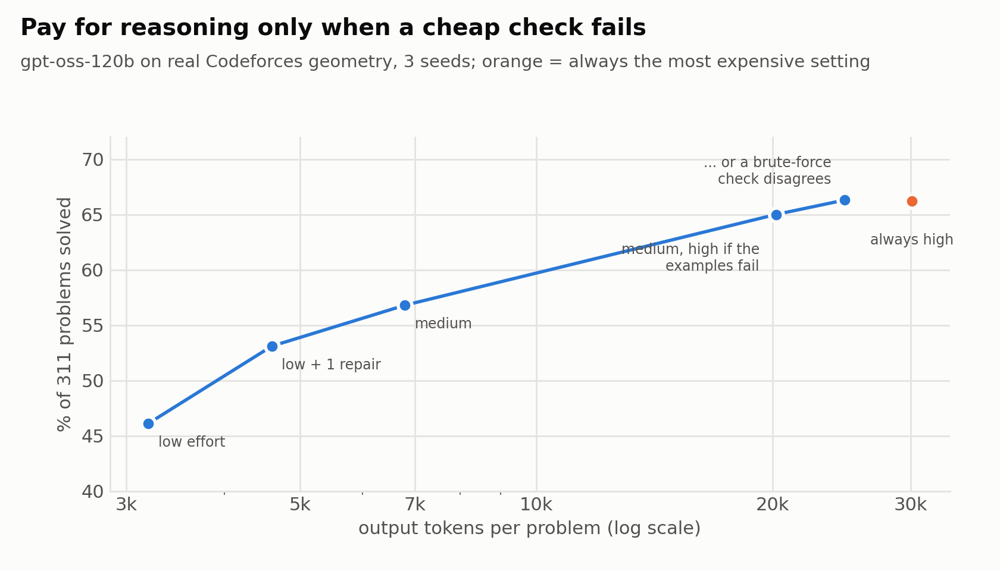
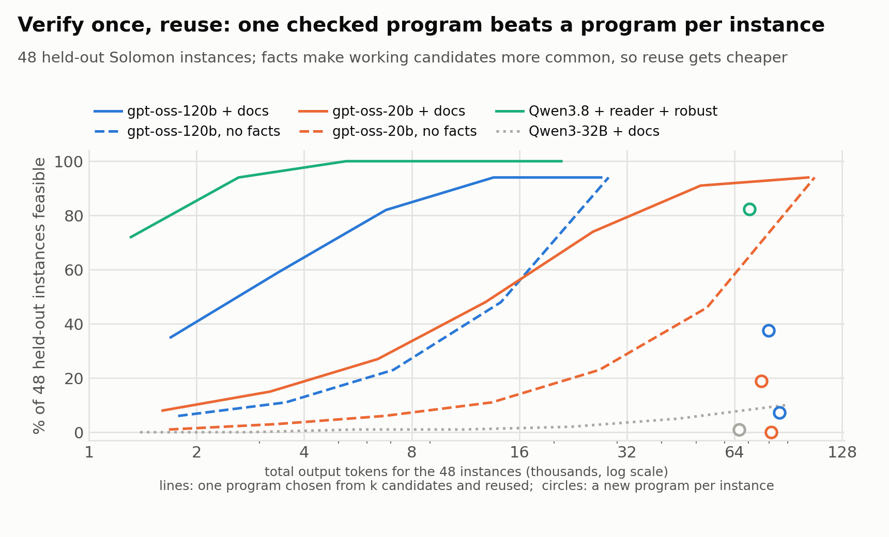

# Solving Computational Math with LLMs, Accurately and Cheaply

*Tools, Facts, and Checks. Graduate NLP course project proposal (POSTECH CSED490E, Team 5).*

> **About this file.** The proposal in short; Korean version: [PROPOSAL_ko.md](PROPOSAL_ko.md). Every run, number and correction is in
> [docs/FINDINGS.md](docs/FINDINGS.md); each experiment's predictions and results in `docs/prereg/`; how to run everything in [README.md](README.md).

## 1. The problem

**Computational math** means problems whose answer is *computed*, exactly:

| Kind | Example | Answer |
|---|---|---|
| Geometry | How many corners does the tightest rubber band around these 10 points have? | 6 |
| Optimization | Plan delivery routes for 100 customers, each with an opening time window, using the fewest kilometres | a route plan |
| Contest problems | *Make a triangle!* (Codeforces): sticks of 2, 5 and 3 cm; how many cm must be added before they form a triangle? | 1 |
| Word problems | Process A uses 3 gold and 2 wires to plate 5 coins; B uses 5 gold and 3 wires for 7. With 500 gold and 300 wires, how many coins at most? | 750 |
| Competition math | AIME, MATH-500 | a number |

An LLM can answer in text, **write a program** and run it, or **think longer** first (a reasoning mode that writes thousands of extra tokens). For computation, text is unreliable: asked for twice the area of one polygon in 8 equivalent copies (moved, rotated, mirrored), Qwen3-8B answers 436, 2944, 392 and 728; the program it writes is right on all 8.

But programs fail **silently** (they still print an answer), and thinking is **expensive**: on 311 real contest problems, gpt-oss-120b solves 57% at medium effort (6.8k tokens per problem) and 66% at high effort (30k tokens), 4.4× the cost for 9 more points.

**Goal.** Solve these problems **effectively** (exactly right under strict checks) and **efficiently** (the fewest tokens, the smallest GPU). The question is *where* extra effort should go.

## 2. Our answer: a recipe

1. **Write a program** for anything that needs exact computation.
2. **Add the missing fact**: a few lines of exact usage, not a whole manual and not extra tools.
3. **Run a free check**: the examples in the problem statement, or two different versions that should agree.
4. **Think harder only when the check fails.**
5. **When the same problem returns with new data, reuse the program that passed.**

Each step is a measured result (Section 3). Together they beat the usual ways of spending compute (Section 4).

## 3. Evidence for each step

**Step 1. Write a program, where exact computation is needed.** Programs win on geometry and optimization (the polygon above). On short-answer competition math, text is as good or better (Qwen3.6 on MATH-500: text 98.3%, program 86.8%); there the program is most useful as a *second opinion*: when gpt-oss-20b's text answer and program agree, only 0.3% are wrong (two text answers that agree: 1.5%).

**Step 2. Add the missing fact; it beats thinking.**
> *Example* (Qwen3-32B, delivery routes with OR-Tools). With the whole OR-Tools manual it calls a method that does not exist, `RegisterUnaryLongLivingCallback`, and crashes. With 5 lines showing the right call, `RegisterUnaryTransitCallback`, it finds the optimal plan.

| Delivery routing (CVRP), Qwen3-32B | optimal |
|---|---|
| task only | 23% |
| task only, think longer | 3% |
| task + whole manual | 7% |
| **task + 5 exact lines** | **77–90%** |

Thinking cannot supply a fact the model lacks, and it can make things worse: on word problems (NL4OPT, IndustryOR) thinking *lowers* Qwen3-32B from 65.4% to 52.0%, because while reasoning it invents `Objective().SetMaximize`; with a 6-line snippet thinking helps instead (72.0%). On the 56 Solomon routing benchmarks, three facts together (file layout, "OR-Tools needs integers", a start strategy) take gpt-oss-120b from at most 6% to 100% valid plans. **Less is also more for tools:** 8 helper functions the task does not need lower Qwen3-32B on geometry from 77% to 59%, because it builds its method on an offered helper.

The smaller the model, the more one fact helps:

**Step 3. Run a free check, and know what it misses.** The examples in a problem statement never reject a correct program, but 24–37% of gpt-oss-120b's *wrong* contest programs pass them too. Checks that look at the problem differently catch more: two programs written with and without the extra tools, or a text answer against a program, make different mistakes.

**Step 4. Think harder only when the check fails.**
> *Example* (gpt-oss-120b). *Make a triangle!* (rated 800): the quick medium-effort program passes the examples, so it is submitted, correct, at no extra cost. *Arrow* (rated 2000): the quick program prints the wrong corners on the example, so only this problem gets high effort (4k + 13k tokens), and the new program is correct.

- Contest geometry: same accuracy as always using high effort (66.3% vs 66.2%) with 18% fewer tokens (24.7k vs 30.1k).
- Geometry with extra tools (Qwen3-32B, 3 seeds): write the program with and without the tools and think only if they disagree: 99% at 4.3k tokens, vs always thinking 98% at 5.9k.
- It fails when both versions share the same mistake (gpt-oss-120b's two contest programs).

**Step 5. Reuse a checked program when the problem repeats.**
> *Example* (gpt-oss-120b, Solomon routing: think of each instance as one day's orders). Writing a new program every day gives a valid plan on 7% of 48 days (≈ 86k tokens). Writing 16 programs once, keeping the one that is valid on 8 past days and reusing it gives a valid plan on 94% (28k tokens in total).

The reused programs also work on 4× larger instances (60 of 60). When the rules change (job-shop scheduling gains release dates), asking the model to *edit* the working program with "change as few lines as possible" beats starting over (Qwen3-32B: 10% → 68% valid schedules).

## 4. Putting it together

We compared ways to spend the same budget on geometry and optimization suites (3 models, 624 problems, 3 seeds):

| Policy | solved | tokens per problem |
|---|---|---|
| first program, no help | 63% | 0.7k |
| think on the hardest-looking problems (the usual "compute by difficulty") | 74% | 4.1k |
| think when the check fails | 77% | 4.2k |
| choose the fix by failure type | 83% | 4.2k |
| **fact first, think only when the check fails** | **87%** | **2.5k** |
| same, with automatically retrieved facts (BM25) | 84% | 3.3k |

The recipe is both the most accurate and among the cheapest, on every seed. Difficulty is the wrong signal: spending thinking on the hardest-looking problems is worse than spending it where a check fails.

**Small GPUs.** Once they get the fact, models that fit one 24 GB GPU (e.g. RTX 3090) match or beat Qwen3-32B. Optimization suite with the recipe: gpt-oss-20b 94–97%, Qwen3-14B (4-bit) 87–92%, Qwen3-32B 79–85%. Word problems: gpt-oss-20b with the recipe 73.0% at 0.7k tokens, Qwen3-32B with the fact and always thinking 72.0% at 5.5k. Below 14B the optimization suite stays at 47% or less whatever we add; geometry is solved from 4B up.

## 5. Where the recipe stops

- **Knowledge that is not a library fact.** For Lean proofs (miniF2F), an invented lemma name stands for a missing proof step: telling the model which similar lemmas exist fixes 2.7% of attempts, no better than a fresh try (3.2%). For factual questions (PopQA), thinking adds only 1.8–5 points at 70–200× the tokens, and only for well-known facts.
- **Checks leak.** A wrong program that passes the check is never sent to thinking; that caps every policy above.
- **Hand-written facts.** Automatic retrieval recovers most of the gain (84% vs 87%) but sometimes fetches a near-miss note.
- **Thinking settings matter.** With our sampling settings Qwen3.6 ran out of its 28k-token budget on 213 of 1,680 math problems; with the model card's settings and a larger budget, none of the first 413 did.
- Open models only; mechanisms were first found on generated tasks.

## 6. Setup

- **Strict scoring.** Geometry: right on all 8 copies of each input. Routing and scheduling: every rule satisfied, length compared with the best known. Contest problems: all official tests. Math and word problems: the exact answer.
- **Fair comparisons.** One change at a time, predictions written before each run, 3 seeds per claim, and accuracy always reported with its token cost.
- **Models** (open, run locally): Qwen3 1.7B–32B, Qwen3.6-35B-A3B, gpt-oss-20b and 120b.
- **Benchmarks:** 13 generated geometry tasks; 8 generated optimization problems; 311 Codeforces geometry problems (CodeContests); 56 Solomon routing instances; 82 job-shop instances (OR-Library and larger); NL4OPT + IndustryOR (345 word problems); MATH-500 + AIME 2024/2025 (560); miniF2F (244 Lean proofs); PopQA (1,500 questions).

## 7. Related work and baselines

We measured the published methods on our tasks. **Selecting among programs:** CodeT 96.0%, majority vote 95.7%, DeepConf (model confidence) 94.7%, MBR-exec 93.7%; our symmetry check 99.7%. **Handling tools and documents:** a scope sentence (2609.14157) recovers 2–3% of the tool harm; System 2 Attention is 11 points worse; DRAFT (self-written tool docs) 11–15% vs 87–92% with a fixed tool; DRoC-style retrieval is .12–.40 below the exact snippet; Dynamic Cheatsheet (a notebook of the model's own lessons) 31–40% of unseen routing instances (no facts: 7%). **Spending compute:** difficulty-based allocation (Snell et al.) 74–79% vs the recipe's 87%; FrugalGPT-style cascades and Self-Debugging are part of step 4. **One program for many instances:** FunSearch, HeuriGym, 2605.14141, 2608.27296. **New here:** every fix priced in tokens on exact-answer benchmarks, showing that *facts before compute* is the cheapest way to accuracy, especially for small models.

## 8. Plan

1. Contest geometry on a 24 GB GPU: gpt-oss-20b with check-gated escalation (running).
2. Competition math for small models (Qwen3-4B / 8B / 14B, running) and Qwen3.6 with the model card's sampling.
3. Automatic facts: improve retrieval so the recipe needs no hand-written facts.
4. A closed API model, if access is available; final report.

*Figures:* `poc/make_figures_frame.py` (figs 18–20), `poc/make_figures_explain.py` (fig 14), `poc/make_figures_hard.py` (fig 12).
