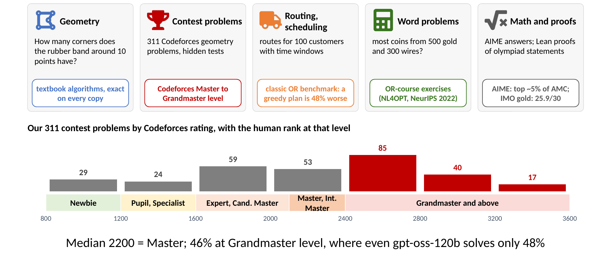
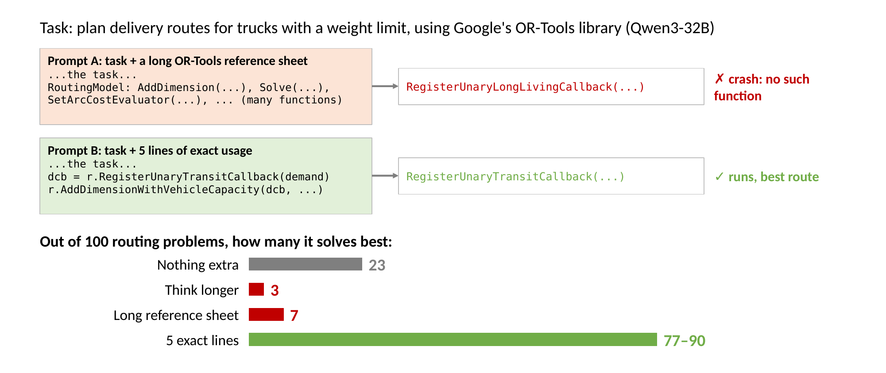
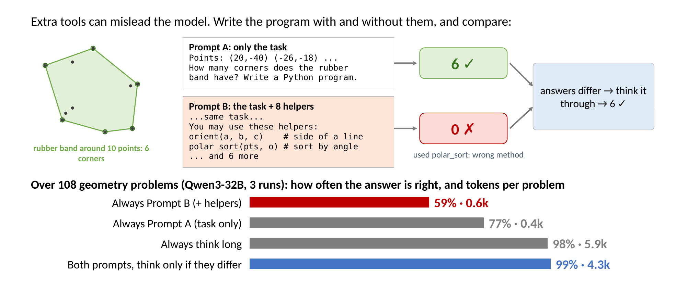
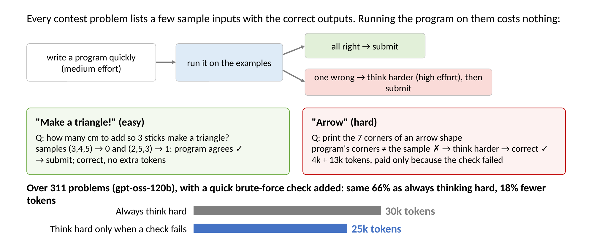
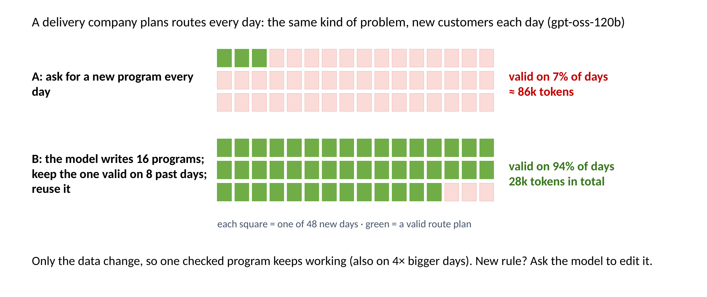
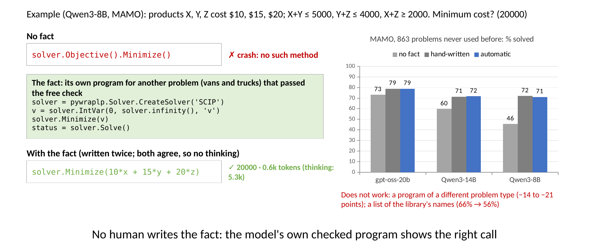
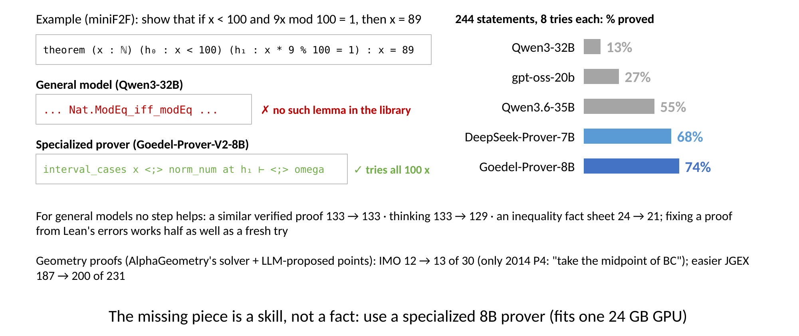
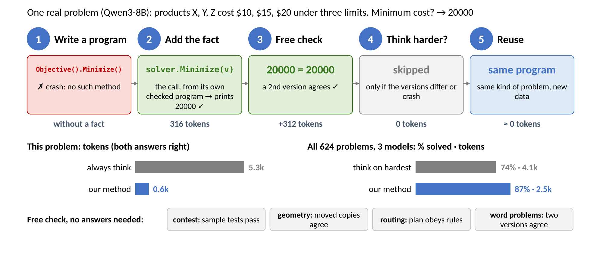

# LLM으로 계산 수학 문제를 정확하고 싸게 풀기

*Tools, Facts, and Checks. 대학원 NLP 수업 프로젝트 제안서 (POSTECH CSED490E, 5조).*

> **이 파일에 대하여.** [PROPOSAL.md](PROPOSAL.md)(영문)의 한국어판입니다. 수치·그림·코드는 영문과 같고, 다를 경우 영문이 기준입니다.
> 모든 실행·수치·수정 기록은 [docs/FINDINGS.md](docs/FINDINGS.md), 실험별 예측과 결과는 `docs/prereg/`, 실행 방법은 [README.md](README.md)에 있습니다.

## 1. 문제

**계산 수학**은 답을 정확히 *계산*해야 하는 문제입니다:

| 종류 | 예시 | 답 | 잘 알려진 기준으로 본 난이도 |
|---|---|---|---|
| 기하 | 점 10개를 감싸는 가장 팽팽한 고무줄의 꼭짓점은 몇 개인가? | 6 | 교과서 알고리즘(볼록 껍질, 신발끈 공식), 단 옮기고 돌리고 뒤집은 사본에서도 정확해야 함 |
| 최적화 | 방문 가능 시간이 정해진 고객 100명에게 가장 짧은 거리로 배송 경로를 짜라 | 경로 계획 | 고전 OR 벤치마크(Solomon 1987); 단순한 탐욕 계획은 알려진 최고 해보다 48% 김 |
| 대회 문제 | *Make a triangle!* (Codeforces): 막대 2, 5, 3 cm. 삼각형이 되려면 몇 cm를 늘려야 하나? | 1 | Codeforces 참가자 등급 기준: 중앙값 2200 = Master; 46%는 Grandmaster 수준(2400+); 18%는 우리 모델 설정 9개 중 아무것도 못 풂 |
| 서술형 문제 | 공정 A는 금 3, 전선 2로 동전 5개, B는 금 5, 전선 3으로 7개를 도금한다. 금 500, 전선 300으로 최대 몇 개? | 750 | 학부 OR 수업 연습문제 수준(NL4OPT, NeurIPS 2022 대회); 어려운 부분은 솔버 API |
| 경시 수학 | AIME, MATH-500 | 수 | AIME는 AMC 응시자 중 상위 약 2.5–5%만 초청 |
| 증명 (확장) | Lean 4로 대회 명제 증명(miniF2F), 또는 기하 정리(IMO) | 컴퓨터가 받아들이는 증명 | IMO-AG-30: 평균 IMO 금메달리스트가 30개 중 25.9개 |

LLM이 이 문제를 푸는 방법은 네 가지입니다: 글로 답하기, **프로그램을 짜서 실행**하기, **솔버 라이브러리를 부르는** 프로그램 짜기(예: 경로에는 OR-Tools), 먼저 **더 오래 생각**하기(수천 토큰을 더 쓰는 추론 모드). 계산에는 글 답이 믿을 수 없습니다: 같은 다각형을 옮기고 돌리고 뒤집은 8개 사본의 넓이(2배)를 물으면 Qwen3-8B는 436, 2944, 392, 728이라고 답하지만, 직접 짠 프로그램은 8개 모두 맞습니다.

답을 계산해야 하는 문제에는 프로그램이 맞는 도구입니다. 단답형 경시 수학에서는 글 답이 같거나 더 낫습니다(Qwen3.6, MATH-500: 글 98.3%, 프로그램 86.8%). 이때 프로그램은 *두 번째 의견*으로 가장 쓸모 있습니다: gpt-oss-20b의 글 답과 프로그램 답이 일치하면 틀린 경우가 0.3%뿐입니다(글 답 두 개가 일치할 때: 1.5%).

그런데 프로그램은 **조용히** 틀리고(틀려도 답을 출력함), 생각은 **비쌉니다**: 실제 대회 문제 311개에서 gpt-oss-120b는 중간 노력으로 57%(문제당 6.8k 토큰), 높은 노력으로 66%(30k 토큰)를 풉니다. 9점을 더 얻는 데 비용이 4.4배입니다.

**목표.** 이 문제들을 **효과적으로**(엄격한 검사에서 정확히 맞게), **효율적으로**(가장 적은 토큰, 가장 작은 GPU로) 푸는 것. 질문은 추가 노력을 *어디에* 써야 하느냐입니다.

**왜 중요한가.** 코딩 에이전트는 이미 경로 계획, 스케줄러, 기하 코드를 씁니다. 토큰은 비용이자 기다리는 시간이고, 많은 팀은 120B 모델이 아니라 24 GB GPU 하나를 가지고 있습니다.

**무엇을 하는가.** 값싼 해결책(빠진 사실, 공짜 검사, 재사용)을 더 오래 생각하기와 비교합니다. 기하, 경로, 스케줄링, 대회 문제, 서술형 문제, 경시 수학, 증명에서 공개 모델로 정확도와 토큰을 함께 재고, 이기는 것들을 하나의 레시피로 묶습니다.

## 2. 한눈에 보는 발견

발견 일곱 가지를 각각 흔한 방법과 비교해 측정했습니다(파랑: 더 나은 방법, 회색: 흔한 방법이나 기존 방법). 3절은 각 발견의 예시와 수치를, 4절은 이를 하나의 방법으로 묶고, 5절은 그 방법을 시험합니다("All together"와 "Choosing the policy" 패널).

## 3. 발견

**발견 1. 매뉴얼이 아니라 사실을 준다: 생각보다 낫다.**
> *예시* (Qwen3-32B, OR-Tools로 배송 경로). 긴 OR-Tools 참조 문서(경로는 있지만 용량 규칙은 없음)를 주면 존재하지 않는 메서드 `RegisterUnaryLongLivingCallback`을 호출해 멈춥니다. 올바른 호출 `RegisterUnaryTransitCallback`을 보여 주는 정확한 사용법 11줄을 주면 최적 계획을 찾습니다 (30문제: 아무것도 없으면 23%, 오래 생각하면 3%, 참조 문서 7%, 정확한 사용법 77–90%, 3 seed).

생각은 모델에 없는 사실을 만들어 내지 못하고, 오히려 해칠 수 있습니다: 서술형 문제(NL4OPT, IndustryOR)에서 생각하면 Qwen3-32B가 65.4%에서 52.0%로 *떨어집니다*. 추론 중에 `Objective().SetMaximize`를 지어내기 때문입니다. 6줄 코드 조각을 주면 생각이 도움이 됩니다(72.0%). Solomon 경로 벤치마크 56개에서는 세 가지 사실(파일 형식, "OR-Tools는 정수만 받는다", 시작 전략)을 함께 주면 gpt-oss-120b의 유효한 계획이 최대 6%에서 100%가 됩니다. **도구도 적을수록 좋습니다:** 필요 없는 보조 함수 8개를 주면 Qwen3-32B의 기하 정답률이 77%에서 59%로 떨어집니다. 주어진 보조 함수 위에 방법을 세우기 때문입니다.

**발견 2. 사실 하나는 작은 모델에 가장 큰 도움이 된다.**
> *예시* (Qwen3-1.7B, 서술형 문제). 사실이 없으면 프로그램이 `status == pywraplp.Solver.SUCCESS`를 확인하거나 `solver.INFINITY`를 쓰는데, 둘 다 존재하지 않는 이름이라 거의 모든 프로그램이 멈춥니다(정답 0.1%). 6줄 코드 조각이 `pywraplp.Solver.OPTIMAL`과 `s.infinity()`를 보여 주면 45%를 풉니다.

모델이 작을수록 이득이 큽니다(Qwen3-32B: 65% → 66%):

**발견 3. 공짜 검사가 실수를 잡고, 서로 다른 두 버전은 더 많이 잡는다.**
> *예시* (Qwen3-14B, 실제 출력). "점 10개를 감싸는 고무줄의 꼭짓점은 몇 개인가?" 프롬프트 A는 과제만 줍니다: 프로그램이 6을 출력, 정답. 프롬프트 B는 필요 없는 보조 함수 8개를 더합니다: 프로그램이 `polar_sort` 위에 방법을 세워 0을 출력. 두 답이 다르므로 이 문제에만 생각을 씁니다. 검사가 놓치는 경우: 대회 문제 *Find Color*에서 어떤 프로그램은 문제에 있는 예제 3개를 모두 통과하고도 숨은 테스트 11번에서 틀립니다.

문제의 예제는 맞는 프로그램을 떨어뜨리지 않지만, gpt-oss-120b의 *틀린* 대회 프로그램 중 24–37%도 통과시킵니다. 문제를 다르게 보는 검사가 더 많이 잡습니다: 도구가 있을 때와 없을 때 짠 두 프로그램, 또는 글 답과 프로그램은 서로 다른 실수를 합니다. 기하 프로그램을 도구가 있을 때와 없을 때 하나씩 짜고 둘이 다를 때만 생각하면 4.3k 토큰에 99%, 항상 생각하면 5.9k에 98%입니다(Qwen3-32B, 시드 3개). 두 버전이 같은 실수를 하면 통하지 않습니다(gpt-oss-120b의 대회 프로그램 두 개).

**발견 4. 검사에 실패할 때만 더 생각한다.**
> *예시* (gpt-oss-120b). *Make a triangle!* (난이도 800): 중간 노력으로 짠 프로그램이 예제를 통과해서 바로 제출, 정답, 추가 비용 없음. *Arrow* (난이도 2000): 빠른 프로그램이 예제에서 틀린 꼭짓점을 출력해서, 이 문제에만 높은 노력을 써서(4k + 13k 토큰) 맞는 프로그램을 얻습니다.

대회 문제 311개 전체에서 예제만 쓰면 20.2k 토큰에 65.0%입니다(항상 높은 노력: 30.1k에 66.2%). 작은 입력에서 모든 경우를 따지는 짧은 프로그램과 답이 다를 때도 높은 노력을 쓰면, 항상 높은 노력과 같은 정확도(66.3% vs 66.2%)를 토큰 18% 적게(24.7k vs 30.1k) 냅니다. 일반 대회 코드(LiveCodeBench, 2025년 문제 182개, 공개 모델 4개)에서는 생각 없이 짠 프로그램을 먼저 내고 예제를 통과하지 못할 때만 생각하면, Qwen3-8B와 Qwen3.5-9B에서 한 번의 전체 생각과 비깁니다(둘 다 −1.3점, 토큰 87–88%). Qwen3-14B와 gpt-oss-20b에서는 집니다. 생각한 프로그램이 예제에서 실패할 때 다시 생각하면 값싼 것 먼저보다 3.7–5.5점 높지만 토큰이 1.6배입니다.

**발견 5. 반복되는 문제에는 검사한 프로그램 하나면 된다.**
> *예시* (gpt-oss-120b, Solomon 경로: 사례 하나를 하루치 주문으로 생각). 매일 새 프로그램을 짜면 48일 중 7%만 유효한 계획(약 86k 토큰). 프로그램 16개를 한 번 짜서 지난 8일에 유효한 것을 골라 재사용하면 94%(전체 28k 토큰).

재사용한 프로그램은 4배 큰 사례에서도 동작합니다(60개 중 60개). 규칙이 바뀌면(잡숍 스케줄링에 작업 투입 시각 추가), 처음부터 다시 짜는 것보다 "가능한 한 적은 줄만 바꿔라"며 동작하는 프로그램을 *고치게* 하는 편이 낫습니다(Qwen3-32B: 유효한 일정 10% → 68%).

**발견 6. 사실은 사람 없이도 찾을 수 있다.**
> *예시* (Qwen3-8B, MAMO). "제품 X, Y, Z의 비용은 10, 15, 20달러; X + Y ≤ 5000, Y + Z ≤ 4000, X + Z ≥ 2000. 최소 비용은?"(답 20000). 사실이 없으면 프로그램이 존재하지 않는 `solver.Objective().Minimize()`를 호출해 멈춥니다. 사실은 자동으로 고릅니다: 다른 문제(밴과 트럭)에 대해 모델이 직접 짜서 공짜 검사를 통과한 프로그램으로, `solver.Minimize(v)`를 호출합니다. 이것을 주면 두 프로그램 모두 `solver.Minimize(10*x + 15*y + 20*z)`를 쓰고 20000을 출력합니다. 둘이 일치하므로 생각이 필요 없습니다(0.6k 토큰; 생각만 하면 5.3k).

처음 쓰는 벤치마크에서 시험했습니다: MAMO(최적화 서술형 문제 863개)는 끝까지 쓰지 않고 남겨 둔 벤치마크입니다. 사실은 자동으로 캡니다: 다른 서술형 벤치마크에서 공짜 검사를 통과한 모델 자신의 가장 짧은 프로그램. 이 사실로 프로그램을 두 번 짜고 둘이 다를 때만 생각하면 손으로 쓴 사실과 같은 성능을 냅니다: gpt-oss-20b 78.8% vs 78.9%(시드 3개 모두 1.2점 이내), Qwen3-32B 75.3% vs 70.7%(시드 3개 모두 더 높음), Qwen3-14B 71.7% vs 71.4%(시드 3개 모두 1.6점 이내), Qwen3-8B 71.0% vs 72.0%(시드 3개에서 −0.9~+2.2점, 토큰은 3분의 1 적게; 사실 없이: 73%, 60%, 46%). 이 사실을 먼저 주면 항상 생각할 때보다 토큰 12–22%로 더 낫습니다. 단, 같은 종류의 문제 안에서만 통합니다: 다른 종류 문제의 프로그램을 빌려 오면 오도하고(최적화 묶음에서 손으로 쓴 사실보다 14–21점 낮음), 라이브러리 이름 목록만 주면 해롭습니다(Qwen3-32B 66.2% → 56.1%). 같은 종류의 사실은 한 문제 유형에서 반복되는 *정식화* 오류도 고칩니다: gpt-oss-20b는 MAMO의 외판원 문제를 모두 해가 없게 정식화합니다(34개 중 0개). 생각은 같은 실수를 되풀이하고(토큰 3.6k로 4%), 올바른 정식화를 설명하는 문장은 잘못 적용되고(9%) — 같은 내용을 코드 조각으로 줘도 마찬가지지만(5%) — 비슷한 문제에서 검사를 통과한 완전한 프로그램은 이를 고칩니다(토큰 0.6k로 52%). 모든 문제에 가장 비슷한 다른 문제의 검사 통과 프로그램을 보여 주면(정답 라벨 없이) MAMO에서 레시피 전체가 1–7점 오르고 토큰은 17–33% 줄어듭니다(모델 3개 × 시드 3개). Qwen3 모델에서는 이득의 대부분이 다른 모델의 프로그램에서 옵니다. 문제가 하나씩 도착하는 경우에도 이득의 대부분이 남지만(+0.4~+3.9점), 문제가 거의 반복되지 않는 NL4OPT + IndustryOR에서는 그렇지 않습니다(토큰은 줄지만 −0.5~−1.4점). **처음 쓰는 더 어려운 OptMATH**(문제 100개, 시드 3개)에서도 핵심 규칙은 일반화됩니다: 값싼 프로그램이 눈에 보이게 실패할 때만 생각하면, 24 GB GPU 모델 세 개 모두에서 항상 생각할 때 토큰의 62–90%로 정확도가 같거나 높고(gpt-oss-20b 38% @ 3.7k vs 33% @ 5.4k), 학습된 STORM-4B(40% @ 14.1k)와 1–2점 차이를 토큰 4분의 1로 냅니다. STORM을 실패 시의 대안으로 쓰면 STORM 단독보다 낫습니다(43% @ 7.0k). 쉬운 문제에서 캔 사용 예시와 두 프로그램 일치 검사는 실패가 정식화·데이터 오류인 OptMATH로는 옮겨 가지 않습니다. **두 번째로 처음 쓰는 OptiBench**(문제 605개, 시드 3개)에서도 규칙이 다시 성립하고(gpt-oss-20b 71% @ 1.2k vs 항상 생각 69% @ 2.1k; Qwen3-14B 59% @ 3.4k vs 48% @ 6.5k; Qwen3-8B는 토큰 64%로 동률), 작은 모델의 실패가 사용법 오류인 이 벤치마크에서는 사실이 효과가 있습니다: 가장 비슷한 다른 문제의 검사 통과 프로그램을 사실로 주면(정답 라벨 없이) Qwen3-14B 64% @ 1.8k, Qwen3-8B 63% @ 2.7k입니다. 여기서는 학습된 STORM-4B가 앞서고(79% @ 7.9k vs gpt-oss-20b 73% @ 1.0k), 우리 값싼 프로그램이 눈에 보이게 실패할 때만 STORM을 쓰면 76% @ 2.3k입니다. 표준 추론 시 기준선인 생각 세 번의 다수결(gpt-oss-20b 75% @ 6.3k)과 비교하면, 눈에 보이는 실패에서만 그 다수결을 쓰는 레시피가 토큰 3분의 1로 같은 정확도를 냅니다(75% @ 1.9k). 모델 × 벤치마크 29개 경우(처음 쓰는 벤치마크 BWOR, LogiOR와 다른 계열 모델 Nemotron-3-Nano 포함) 중 25개에서 라벨 없는 검사 통과 프로그램 모음이 첫 프로그램을 올렸습니다(최대 +34점; 실패가 정식화 오류인 Nemotron-3-Nano의 BWOR, LogiOR에서는 아님). **처음 쓰는 기하 과제 네 개**에서는 gpt-oss-20b(99% @ 0.8k vs 항상 생각 93% @ 1.7k)와 Qwen3-14B(84% @ 2.9k vs 77% @ 8.6k)에서 규칙이 성립하지만, Qwen3-8B에서는 성립하지 않습니다(60% vs 74%): 프로그램의 약 3분의 1이 공짜 검사를 통과하지만 틀리는데, 대부분 주어진 입력에는 없는 경계 경우(한 직선 위의 꼭짓점, 변 위의 점)에서 틀리고, 같은 모델이 짠 두 번째 프로그램(무차별 대입 또는 다시 뽑기)도 같은 실수를 해 41–45%만 잡습니다(최대 66% @ 6.5k). 모델이 문제 설명에서 직접 쓴 경계 경우 테스트는 이 오류를 보지만, 같은 경계 경우의 기대 답을 틀려 거의 모든 문제를 생각 단계로 보냅니다(73% @ 9.1k). 답을 계산하지 않고 문제의 불변 관계만 적게 하면 맞는 오류를 잡지만 관계 자체가 자주 틀립니다(68% @ 7.2k). 이 모델에서는 완벽한 검사도 항상 생각 대비 토큰 70%에서 75%에 그칩니다: 사실 프로그램이 너무 자주 틀리기 때문입니다. **처음 쓰는 벤치마크 두 개, BWOR와 LogiOR**(더 어려운 174문제, 값싼 프로그램 정답률 7–42%)에서는 눈에 보이는 실패에서만 생각하는 규칙이 gpt-oss-20b와 Qwen3-14B에서 항상 생각과 비깁니다(±2점 안, 95% 구간이 0을 포함). 토큰은 항상 생각의 53–88%를 씁니다. Qwen3-8B에서는 집니다(BWOR −8점): 공짜 검사를 통과한 프로그램의 38–75%가 틀리기 때문입니다. 두 프로그램이 같아야 통과시키거나, 모델이 문제 설명에서 쓴 검사 프로그램으로 출력된 해가 모든 제약을 지키는지 확인하면 항상 생각의 정확도를 되찾거나 넘지만(검사 프로그램: gpt-oss-20b와 Qwen3-14B에서 +3–4점. 해를 확인하는 데에도 모델링이 필요한 OptMATH에서는 도움이 되지 않음) 토큰은 더 아끼지 못합니다. 이만큼 어려운 문제에서는 어떤 검사도 토큰을 아낄 수 없습니다. 생각하기 전에 오류 메시지를 보여 주고 한 번 짧게 고치게 하면 추가 비용 없이 +1–4점을 더합니다(세 모델, OptiBench와 OptMATH). 라벨 없는 프로그램 모음은 여전히 효과가 있습니다(LogiOR의 Qwen3-14B, 항상 생각 대비 +10점, 토큰 74%).

**발견 7. 증명에는 사실이 아니라 전용 모델이 필요하다.**
> *예시* (miniF2F). 증명하라: x < 100이고 9x를 100으로 나눈 나머지가 1이면 x = 89. Qwen3-32B는 8번 시도에서 존재하지 않는 보조정리(예: `Nat.ModEq_iff_modEq`)를 인용해 모두 실패합니다. Goedel-Prover-V2-8B는 `interval_cases x <;> norm_num at h₁ ⊢ <;> omega`, 즉 100개 값을 모두 확인하는 증명을 쓰고 Lean이 받아들입니다.

Lean(miniF2F, 명제 244개, 8번 시도)에서는 24 GB GPU 하나에 들어가는 전용 증명 모델이 가장 많이 증명합니다: Goedel-Prover-V2-8B 180개(74%), DeepSeek-Prover-V2-7B 165개, 일반 모델은 Qwen3.6 133개, gpt-oss-20b 66개, Qwen3-32B 31개. 일반 모델에는 우리 단계가 하나도 도움이 되지 않습니다: 비슷한 명제의 검증된 증명(133 vs 133), 생각(129), 10줄 부등식 도구 모음(부등식 50개 중 21 vs 24). 전용 증명 모델에서도 Lean 오류 메시지로 실패한 증명을 고치면 새로 시도할 때의 절반만 증명합니다(Goedel: 107개 중 11 vs 22). 기하 증명: AlphaGeometry의 기호 엔진만으로 JGEX 231개 중 187개, IMO 30개 중 12개를 증명합니다. gpt-oss-20b가 제안한 보조점은 JGEX 13개를 더 풀지만, IMO에서는 어떤 모델도 한 문제(2014 P4, 보조점 "BC의 중점")만 더 풉니다.

## 4. 우리의 방법: 발견으로 만든 레시피

1. 정확한 계산이 필요하면 **프로그램을 짠다** (1절).
2. **빠진 사실을 준다** (발견 1–2): 정확한 사용법 몇 줄. 긴 매뉴얼도, 필요 없는 도구도 아니다. 손으로 쓰거나, 검사를 통과한 모델 자신의 프로그램에서 자동으로 캔다 (발견 6).
3. **공짜 검사를 돌린다** (발견 3): 문제에 있는 예제, 또는 서로 일치해야 할 두 가지 버전.
4. **검사에 실패할 때만 더 생각한다** (발견 4); 서술형 문제에서는 먼저 오류를 보여 주고 값싼 고치기를 한 번 합니다(처음 쓰는 OptiBench·OptMATH에서 시험한 네 모델 모두 바로 생각하기보다 더 정확하고 토큰도 적음, 예: Qwen3.5-9B OptMATH +6.0점; BWOR·LogiOR에서는 고친 프로그램이 돌아가지만 틀리는 Qwen3-8B에 해가 됨).
5. **같은 문제가 새 데이터로 돌아오면, 검사를 통과한 프로그램을 재사용한다** (발견 5).

**실제 문제 하나로 따라가 보기** (Qwen3-8B, 발견 6의 MAMO 문제): 사실이 없으면 프로그램이 멈추고, 사실을 주면 두 버전이 모두 20000을 출력해 일치하므로 생각이 필요 없습니다: 5.3k 대신 0.6k 토큰. 공짜 검사에는 정답이 필요 없고 문제 종류마다 다릅니다(맨 아래 줄).

## 5. 레시피 전체는 효과가 있나?

기하 묶음(108문제)과 최적화 묶음(100문제: 경로, 스케줄링, 패킹)을 모델 3개가 각각 푼 결과(624회, 시드 3개)로 같은 예산을 쓰는 방법들을 비교했습니다. 경시 문제, 문장제, 증명은 따로 시험했습니다(3절, 6절):

| 정책 | 정답률 | 문제당 토큰 |
|---|---|---|
| 첫 프로그램, 도움 없음 | 63% | 0.7k |
| 가장 어려워 보이는 문제에 생각 (흔한 "난이도별 계산량") | 74% | 4.1k |
| 검사에 실패하면 생각 | 77% | 4.2k |
| 실패 유형에 따라 해결책 선택 | 83% | 4.2k |
| **사실 먼저, 검사에 실패할 때만 생각** | **87%** | **2.5k** |
| 같은 방식, 사실을 자동 검색(BM25) | 84% | 3.3k |

레시피는 모든 시드에서 가장 정확하면서 가장 싼 축에 듭니다. 난이도는 잘못된 신호입니다: 어려워 보이는 문제에 생각을 쓰는 것보다 검사가 실패한 곳에 쓰는 것이 낫습니다.

**새 과제에는 어떤 정책?** 방법: 새 과제의 문제 30개에 정답을 달고, 정책 네 가지(값싼 프로그램 하나, 사실 먼저, 두 버전으로 사실 먼저, 항상 생각)를 돌려 토큰 벌점을 뺀 정확도가 가장 좋은 것을 고릅니다. 모델 × 과제 × 시드 63개 칸에서 "사실 먼저, 실패할 때만 생각"이 가장 좋은 고정 기본값입니다(각 칸의 최선 정책보다 평균 1.4점 손해; 항상 생각은 8.4점, 1k 토큰당 0.5점으로 계산). 새 과제의 문제 30개에 정답을 달아 그중 최선 정책을 고르면 손해가 0.6점으로 줄어듭니다(처음 쓰는 MAMO에서: 0.8–1.4점; 처음 쓰는 다른 벤치마크 다섯 개의 45칸에서: 0.87점이고, 레시피가 지는 Qwen3-8B의 기하·BWOR 칸에서는 30개 라벨이 생각을 골라 7.8점 대신 0.74점). 처음 쓰는 벤치마크에서는 항상 생각하기에도 같은 사실을 주어야 공정합니다(사실은 생각도 최대 +22.6점 올림): 그러면 사실 먼저는 gpt-oss-20b와 레시피를 만들 때 쓰지 않은 Qwen3.5-9B에서 다섯 벤치마크 모두 같거나 낫고(토큰 30–78%), Qwen3 모델의 OptiBench·BWOR에서는 사실을 준 생각이 4–12점 더 정확합니다 — 단, 값싼 프로그램을 생각 모드로 2k 토큰 동안 스스로 검토하게 해 통과시키면 여섯 칸 모두 같거나 낫습니다(OptiBench에서 토큰 27–30% 절약); 어디서나 최선인 고정 정책은 없고(손해 3.3점 이상), 30개 라벨은 60칸에서 0.85점 안에서 고릅니다. 다른 계열 모델인 Nemotron-3-Nano-30B-A3B에서도 레시피는 Qwen3에서처럼 동작합니다: OptiBench·BWOR·LogiOR에서 사실 먼저가 6–12점 지고(검사를 통과한 프로그램의 33–70%가 틀림), 자기 검토 관문은 다섯 칸 모두에서 사실을 준 생각과 같거나 낫지만 토큰은 아끼지 못하며(94–109%), 30개 라벨은 1.05점 안에서 고릅니다. 새는 모델을 고치는 것은 생각하는 첫 단계입니다: 사실을 주고 최대 2,000 토큰만 생각한 뒤 첫 프로그램을 쓰고, 그것이 눈에 보이게 실패할 때만 끝까지 생각합니다. 이 방법을 고를 때 쓰지 않은 14칸에서 사실을 준 항상 생각보다 진 적이 없고(−0.3~+10.1점), 서술형 문제에서 토큰을 8–51% 아끼며(Nemotron-3-Nano: 토큰 72–92%로 +3.3~+6.3), 마지막으로 지던 칸을 메웁니다(Qwen3-8B 기하: −16.7 → −0.3). 라벨 없는 고정 기본값으로 써도 네 모델 54칸에서 각 칸의 최선보다 평균 1.47점만 손해입니다. 다만 이 모든 비교의 기준선은 자기 프로그램의 눈에 보이는 실패를 무시하는 한 번의 생각이었습니다. 같은 공짜 검사를 생각에도 주면(프로그램이 눈에 보이게 실패하면 다시 생각) 어려운 서술형 문제에서 +2.5~+12.3점 오르고, 거기서는 값싼 것 먼저 정책 모두보다 정확합니다(gpt-oss-20b도 BWOR −10.2점, 토큰 37%). 레시피는 공짜 절약이 아니라 경계선의 싼 쪽 끝입니다: 공짜 검사는 생각을 포함한 모든 단계에 쓸 가치가 있고, 라벨 없이 가장 좋은 순서는 짧은 생각 → 끝까지 생각 → 눈에 보이는 실패 시 다시 시도입니다(54칸에서 각 칸 최선보다 1.74점 손해; 한 번 생각: 7.64). 같은 순서가 gpt-oss-20b도 고칩니다: 이 모델의 첫 프로그램은 낮은 추론 강도(0.7–0.8k 토큰)에서 나왔는데, 중간 강도의 생각을 2,000 토큰에서 끊어 첫 단계로 쓰면 짧은 생각 → 생각 → 다시 시도가 BWOR(−2.0점)과 LogiOR(+3.3점)에서 다시 시도하는 생각과 비기고(토큰 69–83%) OptiBench에서는 앞섭니다(+2.0점). 더 큰 모델 Qwen3-32B(RTX 3090 2장)에서도 그대로 성립합니다: OptiBench, BWOR, LogiOR에서 짧은 생각 → 생각 → 다시 시도가 가장 좋은 정책이고, 생각 없는 프로그램은 여전히 5–12점 뒤집니다. 즉 새는 문제는 모델이 커져도 줄지 않습니다. 짧은 생각에는 2–4k 토큰이 필요합니다(1k에서는 Qwen3-8B가 OptiBench·LogiOR에서 3–6점 짐). 그리고 이제 검사를 통과한 값싼 프로그램이 틀렸는지 라벨 없이 알아내는 신호가 있습니다: 짧은 생각 프로그램도 돌려 비교하는 것입니다. 숨은 테스트가 있는 Codeforces 기하 311문제에서, 예제를 통과한 생각 없는 프로그램이 모든 테스트 입력에서 짧은 생각 프로그램과 출력이 같으면 93–97%가 맞고, 다르면 19–34%만 맞습니다(서술형 문제: 78% 대 16%). 두 방식이 같은 잘못된 정식화를 공유하는 경우(OptMATH)에만 통하지 않습니다. 이 신호는 프로그램 하나하나를 가려내지만 30개 라벨을 대신하지는 못합니다: 시험용 문제의 정답을 두 방식 프로그램들의 다수결 답으로 대신해 정책을 고르면 고정 순서보다 나쁩니다(각 칸 최선보다 2.00점 손해 vs 1.74; 30개 라벨: 1.35). 같은 실수를 공유하는 프로그램들이 맞는 답을 표로 이기기 때문입니다(Qwen3-8B 기하, OptMATH). 이 규칙을 만들 때 쓰지 않은 과제 세 가지(대회 코드, 도구 호출, 지시 따르기; 48칸)에서는 정답 30개로 고른 정책이 라벨 없는 기본값 "짧게 생각하고 먼저 풀기, 검사가 실패할 때만 전부 생각"보다 낫지 않습니다. 대회 코드만 예외입니다(각 칸 최선보다 시험 선택 1.29 / 1.96 / 1.77점, 기본값 3.07 / 0.23 / 0.92점 손해). 비슷한 정책 열 개 중 하나를 정답 30개로 고르면 약 2점의 잡음이 생기므로, 라벨은 주로 전부 생각을 먼저 해야 하는 대회형 과제를 가려내는 데 쓰입니다.

**작은 GPU.** 사실을 주면 24 GB GPU 하나(예: RTX 3090)에 들어가는 모델이 Qwen3-32B와 같거나 낫습니다. 레시피를 쓴 최적화 묶음: gpt-oss-20b 94–97%, Qwen3-14B(4비트) 87–92%, Qwen3-32B 79–85%. 서술형 문제: 레시피를 쓴 gpt-oss-20b가 0.7k 토큰에 73.0%, 사실을 받고 항상 생각한 Qwen3-32B가 5.5k에 72.0%. 경시 수학: Qwen3-14B(4비트)가 생각 모드로 MATH-500 / AIME 97.3% / 73.3%(Qwen3-32B: 97.4% / 77.2%). 대회 기하: 예제를 틀릴 때만 낮은 노력에서 중간 노력으로 올리는 gpt-oss-20b가 11k 토큰에 54.6%(gpt-oss-120b 중간 노력: 56.8%). 14B보다 작으면 최적화 묶음은 무엇을 더해도 47% 이하이고, 기하는 4B부터 풀립니다.

## 6. 관련 연구와 비교

### 6.1 이 연구의 위치

| 주제 | 가장 가까운 연구 | 그 연구가 하는 일 | 우리가 더하는 것 |
|---|---|---|---|
| 글 대신 프로그램 | PAL, Program-of-Thoughts; Mixture-of-Thought(ICLR 2024) | 모델이 코드를 쓴다; MoT는 글 답과 프로그램이 다르면 상위 모델로 올린다 | 프로그램이 도움이 되는 경우(계산)와 아닌 경우(경시 수학); 글–프로그램 일치를 공짜 검사로 사용 |
| 솔버 코드용 라이브러리 사실 | DRoC(ICLR 2025), CP-Bench(2506.06052), CloudAPIBench(2407.09726), DRAFT | API·솔버 코드용 문서를 검색하거나 다시 쓴다 | 정확한 코드 조각이 매뉴얼과 *생각* 모두를 이긴다; 비슷하지만 틀린 문서 ≈ 문서 없음; 사실을 모델 자신의 검사 통과 프로그램에서 캘 수 있다 |
| 오도하는 문맥과 도구 | "Invisible Lottery"(2606.04057), 필요 없는 도구(2609.14157), CodeCrash, System 2 Attention | 프롬프트의 단서가 코드를 끌고 가거나 해친다 | 정확한 기하에서의 효과(77% → 59%)와, 이를 검사로 바꾸는 해결책(두 버전) |
| 정답 없이 프로그램 고르기 | CodeT, MBR-exec, AlphaCode의 예제 필터, DeepConf, S* | 여러 프로그램 중 최선을 고른다 | 주어진 입력을 옮긴 사본에서 한 프로그램을 검사(99.7% vs CodeT 96.0%) |
| 추론 시 계산량 쓰기 | compute-optimal scaling(Snell 등 2025), FrugalGPT / AutoMix, DART; Thinkless, AdaptThink(RL로 학습한 전환) | 어려운 문제에 더 많은 계산; 학습된 생각/안 생각 전환 | 난이도는 잘못된 신호; 사실 먼저 + 실행 검사가 학습 없이 결정(87% vs 74%); AdaptThink의 기반 모델에서(MATH-500) 학습된 전환이 더 싸고(91.7% @ 1.9k vs 우리 게이트 93.0% @ 3.9k), 생각을 건너뛴 답에 우리 검사를 더하면 2.2점 오름 |
| 최적화 모델링용 LLM | ORLM, STORM / CALM, EVOM, OR-R1(미세조정); OptiMUS, OptiSkill(에이전트, 정답으로 검증한 교사 프로그램의 기술 모음) | 모델링 모델을 학습하거나 에이전트를 만든다 | 학습도 정답도 필요 없음; 처음 쓰는 MAMO에서 레시피를 쓴 24 GB GPU 모델이 미세조정된 ORLM-8B와 같은 수준(아래) |
| 여러 사례에 프로그램 하나 | FunSearch, HeuriGym, ARS, 2605.14141, 2608.27296 | 문제 종류마다 솔버를 한 번 쓴다 | 측정된 차이(7% vs 94%), 정답 없이 프로그램 고르기, 규칙이 바뀌면 검증된 프로그램 고치기 |
| 증명 | Goedel-Prover-V2, DeepSeek-Prover-V2, AlphaGeometry | 전용 증명 모델; 기호 엔진 + 언어 모델의 보조 작도 | 레시피의 사실과 검사는 증명에 통하지 않는다: 전용 8B 증명 모델이 맞는 도구 |

### 6.2 같은 문제, 같은 환경

모두 같은 문제·모델·검사로 우리가 직접 측정했습니다. 정확도 @ 문제당 출력 토큰.

| 과제 (모델) | 기존 방법 | 그 결과 | 우리 방법, 같은 문제 |
|---|---|---|---|
| 생각을 어디에 쓸까 (기하·최적화 208문제 × 모델 3개) | 가장 어려워 보이는 문제에 생각 (compute-optimal scaling, Snell 등 2025) | 74% @ 4.1k (난이도 구간별 최선 해결책: 79% @ 5.2k) | **사실 먼저, 실패할 때만 생각: 87% @ 2.5k** |
| | 사실 없이 검사가 실패하면 생각 (FrugalGPT식 단계적 상향) | 77% @ 4.2k | |
| 대회 기하 (gpt-oss-120b, 311) | 항상 높은 노력 (추론 모델 기본값) | 66.2% @ 30.1k | **66.3% @ 24.7k** (예제 + 무차별 대입 검사) |
| | 예제를 통과한 프로그램만 쓰고 아니면 높은 노력 (AlphaCode 필터 + 단계적 상향) | 65.0% @ 20.2k | |
| | 오류를 보여 주고 한 번 고치기 (Self-Debugging), 낮은 노력에서 | 53.1% @ 4.6k | |
| 프로그램 3개 중 고르기 (Qwen3-8B, 기하, 300) | CodeT (모델이 쓴 테스트) | 96.0% (+340 토큰) | **대칭성 검사: 99.7%** (추가 토큰 없음) |
| | 다수결 (self-consistency) / DeepConf (확신도) / MBR-exec | 95.7% / 94.7% / 93.7% | |
| 라이브러리 문서 (Qwen3-32B, CVRP) | 긴 참조 문서 (용량 규칙 없는 경로 설명) | 7% | **정확한 코드 조각: 77% @ 1.7k** |
| | BM25 검색 / DRoC (제약별로 나눠 검색; ICLR 2025) | 48% @ 2.3k / 72% @ 2.1k | |
| 필요 없는 도구 (Qwen3-32B, 기하 5과제) | 범위 문장 "필요할 때만 쓰라" (2609.14157) / System 2 Attention | 76% / 64% (해결책 없음: 75%) | **필요한 도구만: 92%** |
| 매일의 배송 경로 (gpt-oss-120b, 새 Solomon 사례 48개) | 사례마다 새 프로그램 (표준 방식) / + 한 번 고치기 | 7% / 25% | **검사한 프로그램 하나 재사용: 94%** (전체 28k); 손으로 쓴 사실: 100% |
| | 모델이 쓴 교훈 노트 (Dynamic Cheatsheet) | 31–40% | |
| 서술형 문제 (Qwen3-32B, NL4OPT + IndustryOR) | 프로그램을 쓰기 전에 항상 생각, 사실 없음 (추론 모델 기본값) | 52.0% | **사실 먼저, 실패할 때만 생각: 72.4% @ 1.3k** (사실 + 항상 생각: 72.0% @ 5.5k) |
| 문장형 문제와 경시 수학 (Qwen3-32B) | 표본 3개 다수결 (self-consistency) | 문장형: 프로그램 3개 68.4% @ 1.1k, 생각 3회 79.4% @ 16.4k; MATH-500: 텍스트 3개 89.2% @ 2.3k | **72.4% @ 1.3k** (사실 먼저) / **97.2% @ 3.4k** (텍스트 = 프로그램, 아니면 생각) |
| Lean 증명 (Goedel-Prover-V2-8B, 실패한 명제 107개) | 컴파일러 오류 메시지로 고치기 (Self-Debugging식) | 11개 증명 | 새로 시도: 22개 (같은 토큰) |
| 서술형 문제, 처음 쓰는 MAMO (863) | ORLM-LLaMA-3-8B, 미세조정된 모델링 전문 모델 | 69.5% @ 1.1k | **학습 없는 Qwen3-8B: 69.5% @ 1.0k** (두 버전 검사로 71.0%); **gpt-oss-20b 78.8% @ 1.9k** |
| 경시 수학 (Qwen3-32B, MATH-500) | 글 답과 프로그램이 일치하면 수락, 아니면 생각 (Mixture-of-Thought, ICLR 2024) | 항상 생각할 때 토큰의 77%로 97.2% (항상 생각: 97.4% @ 5.4k); AIME에서는 항상 생각보다 비쌈 | 검사로 사용 (3단계) |

### 6.3 논문에 보고된 수치 (실행 환경과 채점이 다름; 참고용)

| 벤치마크 | 논문 또는 모델 카드의 보고값 | 우리 |
|---|---|---|
| MAMO Easy / Complex | ORLM-LLaMA-3-8B 82.3 / 37.4%(미세조정); STORM-Qwen3-4B 86.3 / 70.3%(SFT + RL); 최상위 모델을 쓴 OptiSkill 90.8–94.3 / 56.8–64.0% | 학습 없이: Qwen3-14B 82.8 / 37.4%, gpt-oss-20b 85.6 / 57.8%; 우리 환경의 ORLM-8B 80.5 / 35.5%; 우리 환경의 STORM-4B 85.7 / 69.5%(전체 81.8%), 토큰 8.4k로 gpt-oss-20b의 4.4배 |
| miniF2F, 32번 시도 | Goedel-Prover-V2-8B 84.6% | 같은 모델을 우리 환경에서: 76.6% |
| IMO-AG-30 기하 | AlphaGeometry 30개 중 25개; 기호 엔진만으로 14개 | 우리 설정에서 엔진만으로 12개; 우리 모델이 제안한 보조점으로 13개 |

**새로운 점.** (1) 모든 방법을 정확한 답이 있는 벤치마크에서 한 환경으로, 정확도*와* 토큰을 함께 비교했습니다. (2) *계산보다 사실 먼저*: 정확한 사실 하나와 공짜 실행 검사가 난이도에 따라 생각을 쓰는 것을 이깁니다. (3) 사실에는 사람도 정답도 필요 없습니다: 같은 종류의 문제 안에서는 모델 자신의 검사 통과 프로그램이면 됩니다. (4) 학습하지 않은 24 GB GPU 모델이 처음 쓰는 벤치마크에서 미세조정된 전문 모델(ORLM-8B)에 도달합니다.

## 7. 레시피가 멈추는 곳

- **증명**에는 사실이 아니라 전용 증명 모델이 필요합니다 (발견 7).
- **빠진 지식.** 사실 질문(PopQA)에서 생각은 토큰 70–200배로 1.8–5점만 올리고, 그것도 잘 알려진 사실에서만입니다.
- **검사가 샌다.** 검사를 통과한 틀린 프로그램은 생각 단계로 가지 않으므로, 위의 모든 정책에 상한이 생깁니다. 서술형 문제의 12–16%가 새지만, 완벽한 검사라도 14B 이상 모델에서 0.8–2.6점(Qwen3-8B 5.6점)만 더합니다: 샌 문제 중 생각으로 풀리는 것은 7–16%뿐이고, 일부는 정답 라벨이 틀린 문제입니다. 처음 쓰는 기하 과제에서 Qwen3-8B의 샌 프로그램은 대부분 주어진 입력에서는 맞고 그 입력에 없는 경계 경우에서만 틀리므로, 검사가 문제에 적힌 경계 경우를 직접 시험해야 합니다: 다른 모델(gpt-oss-20b)의 프로그램과 비교해도 주어진 입력에서 틀린 27개 중 26개는 잡지만 경계 경우에서만 틀린 37개는 하나도 못 잡습니다 — 그리고 그 모델을 그냥 쓰는 편이 훨씬 낫습니다(0.8k 토큰에 99.0%).
- **자동 사실은 같은 종류의 문제 안에서만** (발견 6): 모델이 다른 종류의 라이브러리와 정식화를 베낍니다. 문제 종류마다 사실을 캐는 것이 다음 단계이고, 그동안은 BM25 검색이 이득의 대부분을 지킵니다(84% vs 87%).
- **생각 설정이 중요하다.** 우리 샘플링 설정에서 Qwen3.6은 수학 문제 1,680개 중 213개에서 28k 토큰 예산을 다 썼고, 모델 카드 설정과 80k 예산에서는 4개뿐이었고, 생각 모드 정확도는 91.7 / 47.8%에서 99.6 / 94.4%(MATH-500 / AIME)로 올라 생각 없는 텍스트(98.3 / 68.3%)보다 높아졌습니다. 이득의 대부분은 예산이고, 샘플링 설정은 약 3점을 더합니다.
- 공개 모델만 시험했고, 메커니즘은 처음에 생성한 과제에서 찾았습니다.

## 8. 실험 설정

- **엄격한 채점.** 기하: 입력의 8개 사본 모두 정답. 경로·스케줄링: 모든 규칙을 지키고, 길이를 알려진 최고 해와 비교. 대회 문제: 공식 테스트 전부. 수학·서술형: 정확한 답.
- **공정한 비교.** 한 번에 하나만 바꾸고, 실행 전에 예측을 적고, 주장마다 시드 3개, 정확도는 항상 토큰 비용과 함께 보고(출력 토큰 기준. 입력 토큰까지 세면 처음 쓰는 벤치마크에서 아끼는 양이 줄지만 뒤집히지는 않습니다: 예를 들어 OptiBench에서 gpt-oss-20b의 프로그램 모음 레시피는 항상 생각 대비 46%에서 67%로, 모든 경우 37–97%). 처음 쓰는 벤치마크 비교에는 문제 단위 95% 구간을 붙입니다.
- **모델** (공개, 로컬 실행): Qwen3 1.7B–32B, Qwen3.6-35B-A3B, gpt-oss-20b·120b; 증명에는 Goedel-Prover-V2-8B, DeepSeek-Prover-V2-7B.
- **벤치마크:** 생성한 기하 과제 13개, 생성한 최적화 문제 8개, Codeforces 기하 문제 311개(CodeContests), Solomon 경로 사례 56개, 잡숍 사례 82개(OR-Library와 더 큰 사례), NL4OPT + IndustryOR(서술형 345개), MAMO(서술형 863개, 끝까지 남겨 둠), MATH-500 + AIME 2024/2025(560개), miniF2F(Lean 증명 244개), IMO-AG-30과 JGEX-AG-231(기하 증명), PopQA(질문 1,500개).

## 9. 계획

지난 판 이후 끝난 것: 24 GB GPU에서의 대회 기하와 경시 수학, 모델 카드 설정의 Qwen3.6(핵심 결과 그대로: 86.7–87.5%), 자동 사실과 MAMO 검증, 정답 30개로 정책 고르기, 증명(Lean, 기하).

1. MAMO 반복 실험은 gpt-oss-20b, Qwen3-14B, Qwen3-8B, Qwen3-32B에서 시드 3개로 완료(Qwen3.6은 시드 1개). 같은 환경의 기준선 완료(ORLM, STORM, AdaptThink). 다음: MAMO에서 레시피 뒤에 남는 오류의 약 절반은 정답 라벨이 의심스러운 문제(전체의 7.6%)이고, 나머지는 주로 한 문제 유형에서 반복되는 잘못된 정식화(TSP 순서 제약, 공급 재분배를 등식으로 씀)로, 고치기 한 번이나 생각으로는 고쳐지지 않습니다; 사실 하나로 고쳐지는지 시험 중. (STORM은 생각 없는 모드가 망가져 있어 그 위에 레시피를 얹을 수 없음.)
2. 다른 종류 문제 사이의 자동 사실: 다른 종류의 프로그램을 빌리지 말고 문제 종류마다 사실을 하나씩 캐기.
3. 최종 보고서와 발표 자료; 가능하면 비공개 API 모델.

*그림:* `poc/make_figures_frame.py`(그림 18–22), `poc/make_figures_explain.py`(그림 14), `poc/make_figures_hard.py`(그림 12).
