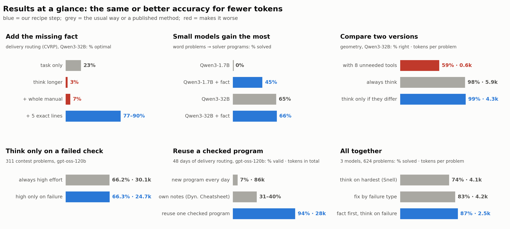
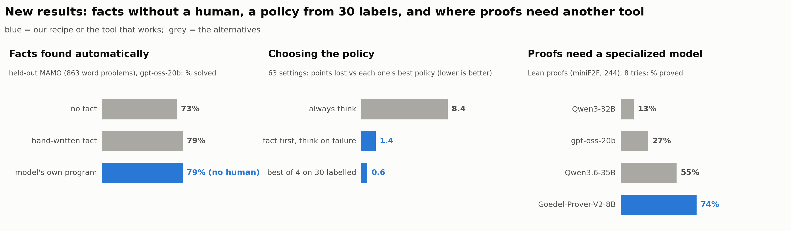

# Solving Computational Math with LLMs, Accurately and Cheaply

*Tools, Facts, and Checks.* POSTECH CSED490E (Graduate NLP) team project, Team 5.

LLMs can solve geometry, optimization, contest and word problems by writing a program. Programs can be silently wrong,
and thinking longer is expensive. We look for the cheapest way to get exactly right answers.

**What we found** (blue = the better way, grey = the usual way or a published method):





**Our method, built from these findings:** write a program → add the missing fact (by hand, or mined from the model's own
checked programs) → run a free check → think harder only when the check fails → reuse a checked program when the problem
repeats. With it, models that fit one 24 GB GPU match Qwen3-32B, and 30 labelled problems pick the policy for a new task.
Proofs are where it stops: a specialized 8B prover beats every general model.

Details: `PROPOSAL.md` (Korean: `PROPOSAL_ko.md`),
`Proposal_Team5.pptx` (5-minute talk in 9 slides with a Korean script in the speaker notes, + 21 extra pages that answer expected questions in the 5-minute Q&A; all findings in `PROPOSAL_slides_full.pptx`), `docs/README.md` (all experiments). Published baselines (compute-optimal scaling by difficulty,
CodeT, MBR-exec, DeepConf, DRoC, System 2 Attention, Self-Debugging, Dynamic Cheatsheet, ...) are measured on the same problems,
and related research is mapped with reported numbers: `PROPOSAL.md` section 6 (and the talk's extra pages).

## Files

```
bench.py                              one entry point: list / serve / run / analyze
PROPOSAL.md, PROPOSAL_ko.md           proposal (English, Korean)
Proposal_Team5.pptx                   5-minute talk (9 slides, Korean script in the notes) + 21 extra pages for questions
PROPOSAL_slides_full.pptx             all findings with examples (21 slides)
HANDOFF.md                            server notes for continuing the work
docs/                                 lab log, one pre-registration + results file per experiment, notes (index: docs/README.md)
poc/                                  code: run_*.py benchmarks, analyze_*.py analyses, queues/ the exact commands we ran
results/                              benchmark inputs and reference solutions (model outputs *.jsonl and logs are not in git)
figs/                                 figures
```

## Setup

```bash
pip install -r poc/requirements.txt sympy math-verify pandas   # generated programs run with this Python, so it needs OR-Tools
pip install vllm                                               # model server (we used vLLM 0.22)
python poc/sanity_check.py                                     # harness check without a model (CPU)
```

**Download models** from Hugging Face (no login needed). They go to `$MODELS_DIR/<model id>`
(default `/SSD/huggingface`). The command checks free disk space first, resumes an interrupted download, and skips
the duplicate weight formats in the gpt-oss repositories (65 GB instead of 196 GB for gpt-oss-120b).

```bash
export MODELS_DIR=/path/to/a/large/disk
python bench.py download q32b oss120        # or: python bench.py download all   (about 180 GB)
python bench.py download all --dry          # only show what would be downloaded
```

## Models and GPUs

One model runs on one GPU. Our setting is a 32k-token context and 88% of GPU memory; high-effort contest runs use a 64k
context. We ran everything on NVIDIA RTX PRO 6000 Blackwell (96 GB). The other GPUs below are estimated from the
weight size plus the memory one full-length request needs. For gpt-oss on GPUs older than Hopper, check that your
vLLM version supports its MXFP4 format there.

| Alias | Model | Download | Smallest GPU | Example GPUs |
|---|---|---|---|---|
| `q8b` | Qwen/Qwen3-8B (16-bit) | 16 GB | 32 GB | A100 40GB, L40S, RTX 6000 Ada |
| `q14b` | Qwen/Qwen3-14B (16-bit) | 30 GB | 48 GB | L40S, RTX 6000 Ada, A100 80GB |
| `q32b` | Qwen/Qwen3-32B-AWQ (4-bit) | 19 GB | 40 GB | A100 40GB, L40S, RTX 6000 Ada |
| `q36` | Qwen/Qwen3.6-35B-A3B-FP8 (8-bit) | 38 GB | 80 GB | H100, RTX PRO 6000 (FP8 needs Ada, Hopper or Blackwell) |
| `oss20` | openai/gpt-oss-20b (4-bit MXFP4) | 14 GB | 24 GB | RTX 4090, L4, A10G |
| `oss120` | openai/gpt-oss-120b (4-bit MXFP4) | 65 GB | 80 GB | H100 80GB, H200, RTX PRO 6000 |

On a smaller GPU, shorten the context and use more of the memory, e.g. `python bench.py serve q8b --frac 0.95 --
--max-model-len 16384`; this lowers the request limit to 16k tokens. On Blackwell GPUs `poc/serve_gpu.sh` sets
`VLLM_USE_FLASHINFER_SAMPLER=0`, which vLLM 0.22 needs there.

## Run

```bash
python bench.py list                                 # benchmarks, arms (prompt conditions), model aliases
python bench.py serve q32b --gpu 0                   # vLLM server on port 8041 (prints the PID; stop with kill <PID>)
python bench.py run geo k8 --model q32b --seed 1     # one arm of one benchmark -> results/
python bench.py run geo k8 --model q32b --dry        # only print the underlying command
```

Run everything from the repository root. One server at a time uses port 8041; to run two models at once, give the
second one its own GPU and port (`serve oss120 --gpu 1 --port 8042`, then `run ... --port 8042`).

## Examples

**Quick test** on one 24 GB GPU with the smallest model:

```bash
python bench.py download oss20
python bench.py serve oss20 --gpu 0
python bench.py run geo none --model oss20 --effort low   # prints, per task, how many programs were right on all 8 copies
```

**Slide 6: library facts** (Qwen3-32B-AWQ, optimization with OR-Tools):

```bash
python bench.py download q32b
python bench.py serve q32b --gpu 0
for arm in nodoc doc snippet; do                          # nothing extra / long reference sheet / exact snippet
  python bench.py run co $arm --model q32b --seed 1
  python bench.py analyze co q32b_co_${arm}_s1            # feasible and optimal per problem
done
```

**Slide 7: distracting tools** (same server):

```bash
for arm in none k8 think; do                              # task only / task + 8 helpers / helpers + thinking
  python bench.py run geo $arm --model q32b --seed 1
done
N10_PREFIX=q32b python bench.py analyze n12 1 geo         # compare the two programs, think only when they differ
```

**Slide 8: hard contest problems** (gpt-oss-120b). The analysis reads the run names `oss120_low`, `oss120_medium`
and `oss120_high64k` for seeds 1–3, so these call the harness directly:

```bash
python bench.py download oss120
python bench.py serve oss120 --gpu 0 -- --max-model-len 65536    # stop the previous server first: kill <PID>
export CC_SET=full POC_BASE_URL=http://127.0.0.1:8041/v1
for s in 1 2 3; do
  POC_REASONING_EFFORT=low    python poc/run_cc.py run oss120_low     $s --max_tokens 16000
  POC_REASONING_EFFORT=medium python poc/run_cc.py run oss120_medium  $s --max_tokens 16000
  POC_REASONING_EFFORT=high   python poc/run_cc.py run oss120_high64k $s --max_tokens 62000
done
python bench.py analyze n8                                # row "medium->high": think harder only when the examples fail
```

`analyze n13` adds the brute-force cross-check behind the 66% result; it also needs the N5 oracle run
(`docs/prereg/PREREG_N.md`).

**Slide 9: reusing one checked program** (gpt-oss-120b, Solomon VRPTW):

```bash
for s in 1 2; do python bench.py run vrptw plain --model oss120 --effort low --seed $s; done
REUSE_SEEDS=1,2 python bench.py analyze reuse_curve oss120_low_plain   # pick on 8 instances, reuse on the other 48
```

**Other benchmarks:**

```bash
python bench.py run math prog --model q32b                  # MATH-500 + AIME, answer by a program
python bench.py run jssp plain --model oss120 --effort low  # job-shop scheduling
python bench.py run nlopt mipf --model q32b                 # word problem -> optimization model, with the solver snippet
python bench.py run popqa recall --model q8b                # factual QA: recall related facts, then answer
```

Each harness (`poc/run_*.py`) explains its options at the top of the file; anything after `--` in `bench.py run` is
passed to it. The exact commands behind every reported number are in `poc/queues/queue_s2_<id>.sh`, and the
predictions and results in `docs/prereg/PREREG_<id>.md`.

Figures and slides: `python poc/make_figures_frame.py` (figs 18–22), `node poc/make_slides.js` (needs `npm install pptxgenjs`),
then `python poc/export_slide_figs.py` (the example pictures `figs/ex_*.png` used in the proposal).
The slide icons (`figs/icons/`) come from `node poc/make_icons.js` (needs react, react-dom, react-icons and sharp).

**Notes:** GPUs are shared: check `nvidia-smi` for a free GPU and port first. We claim a result only if it holds on
3 seeds. Every output row stores its tokens (`out_tokens`), so accuracy can always be read with its cost.
