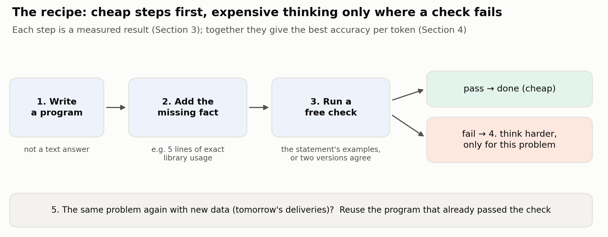
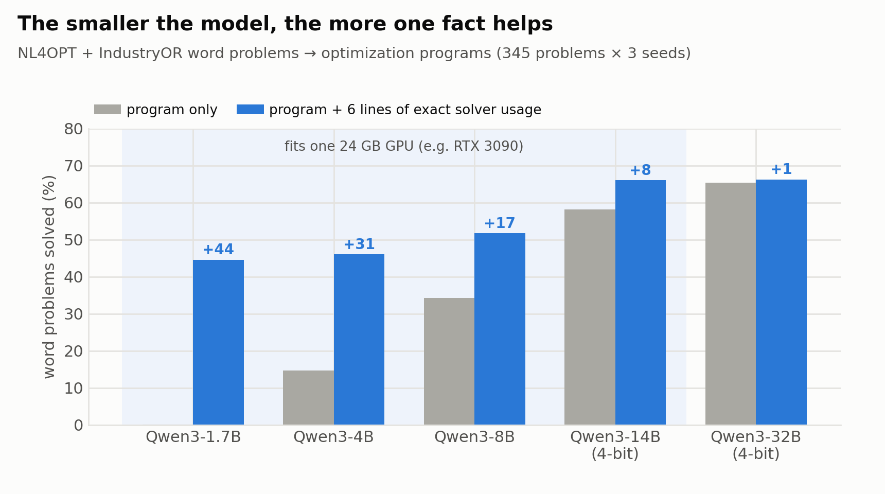
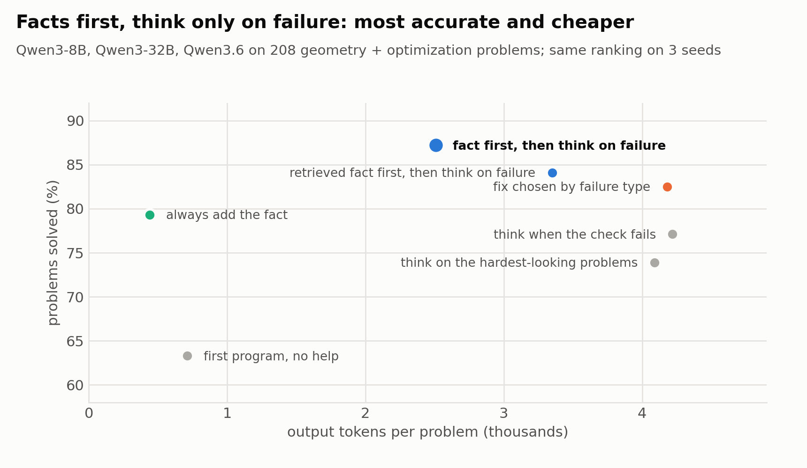
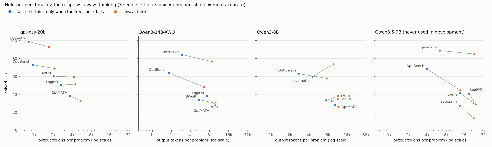
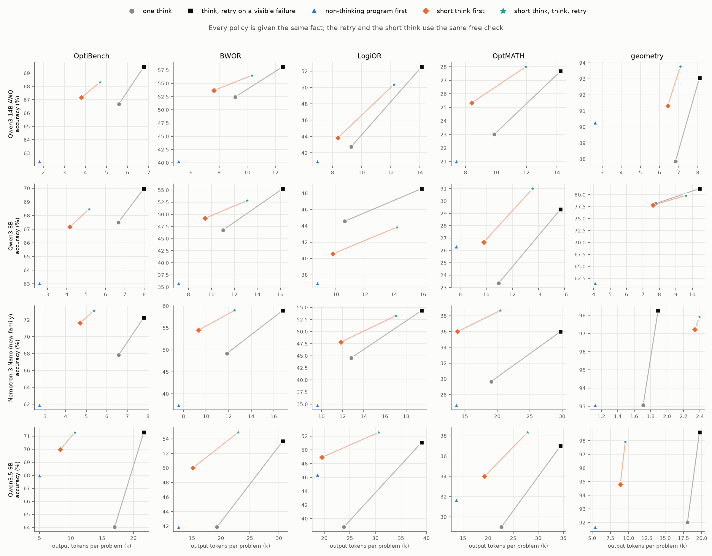

# Facts First, Think on Failure: Solving Problems with LLMs, Accurately and Cheaply

*Draft of the final report, POSTECH CSED490E Team 5 (Sangjun Lee, Seongbin Park). Started 2026-10-23 from `PROPOSAL.md`, the
pre-registrations in `docs/prereg/` and `docs/notes/REPORT_OUTLINE.md`; format and length to be fitted to the course template.*

## Abstract

Many tasks give a language model's answer a free, partial check — a program for a geometry, scheduling or optimization problem runs, a
SQL query returns rows, a tool call parses, a text meets its stated constraints — but a cheap answer can pass it and still be wrong, and
"thinking longer" (long reasoning before answering) is expensive. We ask where a fixed token budget should go,
for open models from 8B to 120B on RTX 3090s. The recipe: write a program, add the missing fact (a few lines of exact library usage, or a
checked program for a similar problem found without labels), run a free check (the program runs and prints a value; outputs on
transformed copies agree), and spend more thinking only where the check visibly fails. The fact is the main lever: the label-free
library raises the cheap program in 25 of 29 model × benchmark cells and raises thinking by up to 23 points. The comparison must be
matched in the fact *and* in the check: one think that ignores its own visible failures is a weak baseline (it is never the best policy
over 54 cells), and giving thinking the check — think again when its program visibly fails — adds +2.5 to +12.3 points on hard word
problems. Against that baseline the recipe is a frontier, not a free lunch: a non-thinking program first costs 37–51% of the tokens and
matches it where the check holds (Qwen3.5-9B, geometry), but trails it on the hardest word problems (2–10 points, even for gpt-oss). For
models whose free check leaks (Qwen3, Nemotron-3-Nano: passing non-thinking programs are wrong 33–79% of the time), writing the first
program after a short think (2,000 tokens with the fact) never loses to one full think in 14 cells it was not chosen on (−0.3 to +10.1),
saves 8–51% of the tokens on word problems and closes the last losing cell (Qwen3-8B geometry: −16.7 → −0.3); for gpt-oss, a
medium-effort think cut at 2,000 tokens instead of low effort closes its gap to the check-matched think on the hard word problems
(tie at 69–83% of the tokens); on Qwen3-32B the order holds unchanged (best utility in 3 of 4 cells; HO-32), and on Seed-OSS-36B, a
fourth family, in all 4 (HO-SEED; its own trained thinking budget overruns 2,048 tokens and is not a better first step). Without labels the best
fixed order over 54 cells of four hybrid-thinking models is short think → full think → retry on a visible failure (1.74 utility points
below each cell's best; one think: 7.64); 30 labelled problems choose per cell within 1.35, but on three task types they were not
developed on the no-label default does as well or better (tool calls 0.23 vs 1.96, instructions 0.92 vs 1.77) except on contest code
(3.07 vs 1.29; PX); on text-to-SQL, a fifth task type none of the rules was built on, the default loses 0.33 and the pilot 2.25, and
the default ties the check-matched think at 69–90% of its tokens while the non-thinking query first loses 2.7–5.9 points (SQL-1).
Trained with plain RL on open data (labels only in training) and checked by another model's quick answer, the non-thinking answer
beats the no-label default on text-to-SQL (+2.0 utility, BIRD dev) and tool calls (+1.35, BFCL; Qwen3-4B +0.94; with the peer trained too
+2.60, the two trainings adding without a cross term); trained to gate itself, it learns to defer everything (CV-1, TC-RL).
Where the check is perfect (Lean proofs) the
rule becomes "sample cheaply, then think"; where it leaks, it bounds label-free self-training as it bounds the recipe.

## 1. Introduction

A program is the natural answer format for a problem whose answer must be computed: the model writes the algorithm, the computer does the
arithmetic. Asked for twice the area of one polygon in eight equivalent copies (moved, rotated, mirrored), Qwen3-8B answers in text 436,
2944, 392 and 728; the program it writes is right on all eight. But programs fail in two ways that text answers hide less well: they crash
on a library call that does not exist, or they run and print a wrong number. The usual remedy is to let the model think longer before it
writes the program, at several times the tokens.

We ask a cost question: **for a given model and problem, where should extra effort go?** Our answer is a recipe built from controlled
experiments, then tested on held-out benchmarks:

1. **Write a program** for anything that needs exact computation.
2. **Add the missing fact**: the few lines of exact usage the model lacks, or the model's own checked program for a similar problem
   (no human, no labels) — not a long manual, not extra tools.
3. **Run a free check at every step**: the program runs and prints a value; its outputs on transformed copies agree; the statement's
   examples pass. For a model whose free check leaks (passing non-thinking programs often wrong), write the first program after a short
   think (2,000 tokens with the fact; 4,000 for the leakiest models, HO-4K) instead of none.
4. **Think harder — given the same fact — only when the check fails, and think again when the thinking's own program visibly fails**;
   on word problems one cheap repair turn shown the error first.
5. **Reuse** a checked program when the same problem returns with new data.

Contributions: (i) every method is compared in one harness with accuracy *and* tokens, against thinking given the same fact *and the
same check* — the comparison most cascade and when-to-think evaluations leave confounded (one think that ignores its own visible failures
is never the best policy in our 54 cells); (ii) an exact decomposition that predicts, per model and benchmark, whether a cheap first step
is a saving or a trade, and the step that fixes the leaky models — a short think first — with a label-free signal for the leak (agreement
between the non-thinking and the short-think program); (iii) facts without a human or labels: other runs' checked programs for similar problems, and the same
programs as fine-tuning data; (iv) held-out evaluation on five unseen benchmarks and an unseen model, with 95% intervals and pre-registered
predictions, including the refuted ones. What is established elsewhere (cascades between models, sampling with a verifier on proofs,
self-training and its collapse) is marked as such (§6.5).

## 2. Setup

**Problems.** Development: 13 generated geometry tasks (convex hull, polygon area, point in polygon, segment intersections, closest pair,
lattice points, rectangle union, Delaunay check, diameter, ...) and 8 generated optimization problems (knapsack, TSP, colouring, scheduling,
bin packing, vertex cover, CVRP, VRPTW); NL4OPT + IndustryOR word problems (345); 311 Codeforces geometry problems with official tests; 56
Solomon routing instances; job-shop instances. Held out (never used to design the recipe): MAMO (863), OptMATH (100), OptiBench (605),
BWOR (82), LogiOR (92), and four geometry tasks (polygon overlap, convexity, points in a triangle, convex clipping; 96 instances).

**Models.** gpt-oss-20b (MXFP4), Qwen3-14B-AWQ (4-bit), Qwen3-8B — all fit one 24 GB GPU; Qwen3.5-9B (bf16, one RTX 3090) as a model
never used in development (§5.4); Qwen3-32B-AWQ, Qwen3.6-35B-A3B and gpt-oss-120b as references; trained baselines STORM-Qwen3-4B and ORLM-LLaMA-3-8B. Served with vLLM 0.22; cheap programs without thinking (gpt-oss at
low effort), thinking with a 16k-token budget (gpt-oss at medium effort).

**Grading.** Geometry: right on all eight copies of each input (moved, rotated, mirrored, permuted, scaled, shifted by 10^9, degenerate).
Word problems: the objective within 1e-2 absolute or 1e-3 relative ('No Best Solution' counts as a value). Contests: all official and
generated tests. Routing / scheduling: every constraint satisfied, compared with the best known solution.

**Cost and protocol.** Cost = output tokens per problem (input tokens reported where prompts differ). Every experiment was pre-registered
with numerical predictions and a decision rule before running (`docs/prereg/`), run with 3 seeds, and refuted predictions are reported
as such. Held-out comparisons carry paired bootstrap 95% intervals over problems.

## 3. Why each step: development findings

**Facts beat thinking when the model lacks knowledge.** Qwen3-32B routing deliveries with OR-Tools: with nothing 23%, thinking longer 3%,
a long reference sheet 7%, eleven lines of exact usage 77–90% (3 seeds). Thinking cannot supply an API fact the model lacks and can invent
more (`Objective().SetMaximize`); on word problems thinking lowers Qwen3-32B from 65.4% to 52.0%, while thinking with a 6-line snippet
reaches 72.0%. Unneeded tools hurt too: eight helper functions the task does not need lower Qwen3-32B on geometry from 77% to 59%.

**One fact helps small models most.** Qwen3-1.7B on word problems: 0.1% → 45% with the 6-line snippet (its programs check
`Solver.SUCCESS`, a name that does not exist); Qwen3-32B: 65% → 66%.

**A free check catches mistakes; different views catch more.** Writing the geometry program with and without the extra tools and thinking
only when the two disagree gives 99% at 4.3k tokens vs 98% at 5.9k for always thinking (Qwen3-32B). The check leaks when both views share a
mistake: 24–37% of gpt-oss-120b's wrong contest programs pass the statement's examples.

**Think harder only when the check fails.** On 311 contest problems gpt-oss-120b at medium effort solves 56.8% at 6.8k tokens and at high
effort 66.2% at 30.1k; escalating to high effort only when the examples fail or a quick brute-force program disagrees gives 66.3% at 24.7k.

**Reuse a checked program.** Solomon routing (48 new instances): a new program per instance gives a valid plan on 7%; writing 16 programs
once, keeping the one valid on 8 past instances and reusing it gives 94% (28k tokens in total).

## 4. Development result: where to spend thinking

On the geometry (108) and optimization (100) suites, three models (Qwen3-32B-AWQ, Qwen3-8B, Qwen3.6-35B-A3B) × 3 seeds:

| policy | solved | output tokens per problem |
|---|---|---|
| first program, no help | 63% | 0.7k |
| think on the hardest-looking problems (difficulty-based, as in compute-optimal scaling) | 74% | 4.1k |
| think when the check fails (no fact) | 77% | 4.2k |
| choose the fix by failure type | 83% | 4.2k |
| **fact first, think only when the check fails** | **87%** | **2.5k** |
| same, facts retrieved automatically (BM25) | 84% | 3.3k |

Difficulty is the wrong signal: thinking where a cheap check fails beats thinking where problems look hard, and adding the fact first
makes it both more accurate and cheaper. Choosing among four policies from 30 labelled problems of a new task loses 0.6 points of utility
on average; using fact-first as a fixed default loses 1.4. The thinking arms of this table think without the fact (on the optimization
suite; the geometry thinking arm has the helpers); the held-out tests (§5.1) compare against thinking given the same fact, which is the
harder baseline.

## 5. Held-out tests

### 5.1 The core rule on unseen benchmarks
Fact first, think only on a visible failure (FF: the cheap program with the fact; thinking — given the same fact — only if it crashes,
prints nothing or prints 'No Best Solution'; on geometry, if the metamorphic check fails) minus **always thinking with the same fact**,
seed means, paired 95% interval over problems, and FF's output tokens as a share of always thinking's. Facts: geometry the needed helpers
+ the algorithm hint; OptiBench (a fixed third, 202 problems), BWOR, LogiOR the label-free library; OptMATH the mined usage example
(Qwen3.5-9B: the library).

| model | geometry (96) | OptiBench (202) | BWOR (82) | LogiOR (92) | OptMATH (100) |
|---|---|---|---|---|---|
| gpt-oss-20b | **+3.1** [+1.0, +5.6], 59% | **+2.5** [+0.5, +4.8], 48% | −1.2 [−6.9, +4.5], 46% | −0.7 [−5.1, +3.3], 63% | **+5.7** [+0.3, +11.3], 68% |
| Qwen3-14B-AWQ | +2.4 [−0.3, +5.6], 39% | **−4.3** [−7.8, −0.8], 33% | **−12.2** [−20.3, −4.5], 56% | −1.8 [−6.2, +2.5], 75% | 0.0 [−4.0, +4.0], 83% |
| Qwen3-8B | **−16.7** [−21.9, −11.5], 53% | **−4.5** [−8.1, −1.0], 39% | **−11.0** [−16.7, −5.7], 65% | **−7.6** [−11.6, −3.6], 82% | +1.7 [−1.3, +5.0], 88% |
| Qwen3.5-9B (§5.4) | −0.3 [−3.1, +2.4], 30% | **+4.0** [+1.0, +6.9], 30% | 0.0 [−4.9, +4.9], 66% | **+7.6** [+3.6, +12.0], 78% | +2.7 [−3.3, +8.7], 60% |

The fact is the main lever: it raises thinking as well (+3.5 to +22.6 points over thinking without it; Qwen3-14B-AWQ on OptiBench 44.1% →
66.7%). Given the fact, thinking only on a visible failure ties or beats always thinking on every benchmark for gpt-oss-20b and Qwen3.5-9B
at 30–78% of its tokens, and for Qwen3-14B-AWQ on geometry, LogiOR and OptMATH. For Qwen3-14B-AWQ on OptiBench / BWOR and for Qwen3-8B on
four of five, thinking with the fact is 4–17 points more accurate: there the recipe trades accuracy for tokens (§5.2 explains why).
Without any fact on either side the earlier comparison holds (OptiBench +1.8 / +11.0 / −0.4, BWOR +1.2 / +1.2 / −8.1, LogiOR −1.1 /
−2.2 / −2.9 for the three development models). Counting input tokens shrinks the savings but reverses none.

*Each pair: always thinking with the same fact (orange) and the recipe (blue) on one held-out benchmark, seed means; a pair pointing up-left means more accurate and cheaper. Facts: OptMATH the mined usage example, OptiBench / BWOR / LogiOR the label-free library, geometry the needed helpers + hint. Right panel: Qwen3.5-9B, never used in development (§5.4; OptMATH with the library, thinking at a 32k budget); OptiBench on its fixed third (`poc/make_figure_heldout.py`).*

### 5.2 Why it fails: the check leaks
Exactly, FF − always thinking = P(check passes) × [P(cheap program right | passes) − P(thinking with the fact right | passes)]: the recipe
can lose only on problems its check lets through. Against the fact-matched arm the second factor decides every cell: where FF wins or
ties, the passing cheap programs are about as often right as thinking with the fact would be on them (gpt-oss-20b OptiBench 80% vs 77%;
Qwen3.5-9B LogiOR 74% vs 52%; geometry 95–100% vs 94–96% for the three stronger models); where it loses, thinking with the fact solves far
more of them (Qwen3-14B-AWQ BWOR 42% vs 64%, Qwen3-8B BWOR 31% vs 55%, Qwen3-8B geometry 67% vs 92%). The leak alone does not decide it:
62% of Qwen3.5-9B's passing OptMATH programs are wrong, but thinking with the fact is no better on them (34%), so FF ties.

Where FF loses, its free check lets wrong programs through. On BWOR and LogiOR the cheap programs are right on only 7–42% of problems and
38–75% of the programs that run and print a number are wrong (Qwen3-8B on BWOR: 75%). On held-out geometry 64 of Qwen3-8B's 216 fact
programs pass the metamorphic check yet are wrong; reading them, 37 answer the given instance correctly and fail only the degenerate copy —
a convexity test that crashes when the first three vertices are collinear, a point-in-triangle test that counts points on an edge — edge
cases the statement names but the given input does not contain, so no check on the given input can see them.

We tried three label-free second views against this leak (pre-registered, 3 seeds): a brute-force program by the same model, a second
sample, and edge-case tests the model writes once per task from the statement. The first two catch 41–45% of the leaked programs (the
brute force copies the same textbook snippet); the tests see the leaks (59 of 64) but compute the same boundary cases wrong, flagging 67% of
correct programs. A fourth view — invariances the model states from the statement without computing any answer ("a point added exactly on an edge does not change the count") — catches the right failures (23 of the 37 edge-case leaks) but its relations are often wrong too (54% false alarms), reaching 67.7% at 7.2k. None lets FF reach always-thinking for Qwen3-8B (74.0% at 9.8k).

Nor does one repair turn on the flagged programs (only 13% of its repairs pass the check), nor a program from a different model: requiring gpt-oss-20b's fact program to agree catches 26 of the 27 leaks that are wrong on the given input and none of the 37 edge-case-only ones (63.2% at 6.5k) — the self-correlated part of the leak is removable, the edge-case part is invisible to any check on the given input; and gpt-oss-20b alone solves 99.0% at 0.8k, so a stronger second model is a reason to switch, not a check. Even handing a differential test the benchmark's own edge inputs (agreement
with a second sample there) catches 32 of the 37 edge-case leaks but reaches only 71.9% at 78% of always-thinking's tokens. On BWOR / LogiOR,
requiring two cheap programs to agree recovers always-thinking's accuracy in every cell but costs 91–120% of its tokens. **The saving of the recipe is
bounded by its check's leak.**

On BWOR / LogiOR a stronger check helps accuracy: a solution checker the model writes from the text (it tests every stated constraint on the printed solution and recomputes the objective) catches 66–97% of running-but-wrong programs (but flags 18–65% of right ones) and turns the recipe into a significant gain over always thinking (without the fact, as in HO3) for gpt-oss-20b (+3.7, +4.3) and Qwen3-14B-AWQ on BWOR (+3.3), at 102–110% of its tokens. On OptiBench, where cheap programs are usually right, the same checker does not pay: the plain recipe with the library already beats always thinking by +5.0 / +15.0 / +7.2 points at 36–55% of its tokens, and the checker's false alarms cost what its catches gain. Nor does it carry over to OptMATH (−1.4 to −2.3 points), whose solutions contain auxiliary formulation variables that the checker must re-interpret: a check helps only where it is a genuinely independent view.

**One cheap repair before thinking.** A cheaper first escalation helps where checks cannot save tokens: one short repair turn shown the error (no thinking) before thinking is never worse than the plain recipe and adds +0.7 to +4.0 points on OptiBench and OptMATH for all three models at equal or lower cost — where a repair runs, it is right more often than thinking on the same items. On the unseen Qwen3.5-9B it adds +2.0 to +6.2 points on all four word benchmarks at 73–88% of the plain recipe's tokens (pre-registered, HO-N3), so it is the recipe's first escalation on word problems. On BWOR / LogiOR it again helps the stronger development models but not Qwen3-8B, whose repaired programs run but are mostly wrong there (exploratory); on held-out geometry it adds little (+0.7 / +1.7 for the stronger models), because "these copies disagree" is less actionable evidence than a Python error.

Agreement with gpt-oss-20b's program is a better check on BWOR / LogiOR than a self-written checker (+1.4 to +3.3 points over it for both Qwen models, half the false alarms), but again dominated by using gpt-oss-20b.

**A cost model** (against thinking without the fact, as these analyses were run). A perfect check bounds what any check can do: on held-out geometry it lifts Qwen3-8B only to 75.0% at 70% of always-thinking's tokens (its fact programs are wrong too often), while gpt-oss-20b and Qwen3-14B-AWQ reach 99.0% at 49% and 84.4% at 38%; on BWOR / LogiOR a perfect check saves no tokens (83–103%) but raises accuracy above always thinking (e.g. gpt-oss-20b BWOR 69.5% vs 59.3%). The recipe's token saving is capped by how often the cheap program is right; the check's leak decides how much of the possible accuracy it keeps.

### 5.3 Facts without a human
The label-free library — for each problem, the program for the most similar other problem of the same benchmark that passed a strict check
(two runs agree, not 'No Best Solution') in any of the three models' runs — raises the first program in 25 of 29 model × benchmark cells
(e.g. OptiBench +7 / +17 / +24 points for gpt-oss-20b / Qwen3-14B-AWQ / Qwen3-8B; BWOR and LogiOR +5.7 to +14.9); it hurt only the gpt-oss
models on OptMATH, whose failures are formulation and data errors, not usage, and did not help Nemotron-3-Nano on BWOR / LogiOR (−1.6,
−2.2; +16.3 on OptiBench). On held-out MAMO the model's own mined program matches the
hand-written snippet (gpt-oss-20b 78.8% vs 78.9%; Qwen3-32B 75.3% vs 70.7%).

**When does a fact pay?** The share of first programs that crash with a usage exception predicts the gain (r = 0.60 over 58 points; mean
+10.9 points where ≥ 5% crash this way, +2.1 below). A rule fixed from 46 points ("add a fact unless usage crashes < 5% and other failures
≥ 25%") was right in 18 of 20 new points (BWOR / LogiOR for the three development models; four benchmarks for Qwen3.5-9B), all on its
"add" side. It does not transfer: on the label-free fine-tuned models, the first to reach its "do not add" region, it was right on 2 of 5
"do not add" and 3 of 6 "add" points (WF5), and on Nemotron-3-Nano, a model from another family, on 3 of 8 (HO-N4). The pattern is by kind
of fact: after fine-tuning the usage card pays nowhere (−6.9 to +2.8) while the library of similar problems' programs still adds +4 to +7
on 5 of 6 points — the usage fact is in the weights, the formulations of other problem types are not — and a usage-crash census sees only
the first. On Nemotron-3-Nano neither fact helps on BWOR / LogiOR (its failures there are formulations; the card even pushes it onto one
solver and into API mix-ups, LogiOR −6.9). The census is a description of where usage facts paid on the development models; the choice
of fact is left to the pilot. A hand-written usage card fails where it misses the library the model reaches for (Qwen3-8B on routing problems
writes `from ortools.constraint_solver import pywraplp`), while working code of a similar problem transfers.

### 5.4 A model the recipe was never developed with
All rules above were fixed on gpt-oss-20b and the Qwen3 models. On Qwen3.5-9B (a newer generation, bf16 on one RTX 3090; thinking with the
model card's sampling and a 32k budget), pre-registered before any run: fact first, think on a visible failure beats always thinking without the fact on all
five held-out benchmarks (OptiBench 68.3% vs 44.7%, +23.5 [+20.8, +26.3] at 30% of its tokens; +3.8 to +14.3 elsewhere), and ties or
beats always thinking *given the same fact* on all five (OptiBench +4.0 [+1.0, +6.9], LogiOR +7.6 [+3.6, +12.0], the others ties; 30–78%
of its tokens; HO-TF2). Its thinking fails
by library misuse (14–25% of programs) and unfinished reasoning (6–32% at 32k): the fact, not the effort, is what it lacks. The census
called "add a fact" on all four word benchmarks and both facts paid (+3.7 to +19.7; 8 / 8 calls right).

**A model from another family** (HO-N4): NVIDIA-Nemotron-3-Nano-30B-A3B, a hybrid Mamba-Transformer mixture of experts, on 4 × RTX 3090,
everything pre-registered from the rules above. It behaves like the Qwen3 models, not like gpt-oss or Qwen3.5: its passing non-thinking
programs are wrong in 33–79% of word-problem cases, so fact-first loses to thinking with the same fact on OptiBench (−5.9 [−9.4, −2.5]),
BWOR (−11.8) and LogiOR (−9.8) and ties only on OptMATH (−3.0 at 72% of the tokens) and geometry (0.0 at 66%, 5% leak). The self-review
gate transfers: it ties or beats thinking with the fact in all 5 cells (LogiOR +2.2 [+0.7, +4.0], geometry +1.7 [+0.3, +3.8]), but at
94–109% of the tokens (221% on geometry, where it raises false alarms on 64% of right programs). The library pays on OptiBench (+16.3)
but not on BWOR / LogiOR, the census was right on 3 of 8 calls, and the 30-label pilot loses 1.05 points (best fixed policy: two
agreeing cheap programs, 0.80). What transfers across families is the decomposition — the leak decides the side — and the gate's
accuracy; the token saving belongs to models whose free check does not leak.

### 5.5 Knowing when not to use it
The recipe's losses are detectable before deployment. Label 30 random problems of a new model × benchmark cell, run the four policies on
them (the cheap program alone, fact first, fact first with two agreeing programs, always thinking) and keep the best by accuracy − 0.5 ×
ktokens. Over the 45 held-out cells (3 models × 3 seeds × five benchmarks, each with the recipe's fact) the pick is 0.87 points from the
cell's best on average (10 labels: 2.81; always using fact-first: 1.80; always thinking: 5.86); on the unseen Qwen3.5-9B, 0.81 over 15 cells. With repair-first as a fifth policy over all 60 held-out cells the pilot's regret is 0.94, and always repairing first (1.22 on the 48 word cells) beats always using the plain recipe (2.85), though it loses accuracy on BWOR for all three development models (HO-R). Against the fact-matched thinking arm no fixed policy is good everywhere (best fixed regret 3.32) and the pilot matters most: 30 labels keep the regret at 0.85, choosing thinking with the fact in the 17 of 60 cells where it is best (HO-P2). In Qwen3-8B's geometry and BWOR cells, where
the recipe loses, the 30 labels pick thinking: 0.74 points of regret instead of 7.83 (pre-registered, `PREREG_MODEL.md`, addendum HO-P). The labels are needed: estimating accuracies from how often the cheap program, a second sample and thinking agree (no labels) keeps fact-first in exactly those cells (regret 1.71 overall, 11.2 on Qwen3-8B geometry), because a model's cheap programs share their mistakes and vouch for each other (HO-L). Where no labels are available, the 2k-token
self-review gate (§5.6) is the best fixed policy for the leaky Qwen models: over the 39 cells with reviews it loses 2.52 points to each
cell's best, against 3.99 for always thinking with the fact and 5.17 for repair-first; given 30 labels, adding it to the pilot gains only
+0.28 (regret 0.96), because the pilot already finds a near-equal policy in the cells the gate wins (HO-P3). Short thinking first
(§5.6) changes this: over 54 cells of the four hybrid-thinking models it is the best policy in 28 and the three-step cascade (non-thinking
program, then short thinking, then full) in 12; always using short thinking first loses 1.47 to each cell's best, where the best other
fixed policy loses 5.8, and adding the two to the 30-label pilot raises its utility by +2.1 per cell (regret 1.19; HO-P4).
On the three task types the pilot was not developed on (PX, pre-registered, 48 cells, each type's whole menu of about ten policies) it
does not carry over: it loses 1.29 / 1.96 / 1.77 points to each cell's best on contest code / tool calls / instructions, where always
using the default order (short think, full think on a visible failure) loses 3.07 / 0.23 / 0.92. Picking the best of ten close policies
on 30 labels costs about two points of selection noise (the optimizer's curse), so the labels pay only where the default is wrong by
more — contest code, where one plain think does as well as the pilot (1.24); 100 labels bring it to 0.25 / 0.74 / 0.82. On 33
word-problem cells no pilot had seen (Qwen3-32B-AWQ, Seed-OSS-36B, gpt-oss-20b; PX2) always using the default loses 0.72, the argmax
pilot 1.30, and a pilot that switches only on a significant paired gain 0.79: labels add noise or nothing, and 30 of them cannot see
contest code's loss (2.76). On text-to-SQL (SQL-1, 9 cells, pre-registered before any row) the default loses 0.33, the argmax pilot
2.25, the gated pilot 0.35 (§5.11).

### 5.6 Larger models, stronger checks, shorter thinking
- **gpt-oss-120b** (4 × RTX 3090, tensor parallel): fact-first ties thinking with the same fact on OptiBench, BWOR and LogiOR (−1.0, +3.7,
  0.0) at 50–63% of its tokens (HO-LG).
- **A stronger check where the plain one leaks**: accepting the library program only if a solution checker written from the text passes
  its printed solution closes the Qwen3 models' gap to thinking with the fact in all five losing cells (−4 to −12 → −1.6 to +1.0), but saves
  tokens only on OptiBench (71–79%); on BWOR / LogiOR it escalates almost everything (HO-VF).
- **A short self-review as the gate** (HO-VR): the same Qwen3 model, thinking for at most 2k tokens, reviews its passing program and
  answers CORRECT / WRONG; escalating on WRONG makes fact-first tie or beat thinking with the fact in all six Qwen3 cells (−1.1 to +2.9),
  at 70–73% of its tokens on OptiBench and ~100% on BWOR / LogiOR, where even a perfect check saves at most 12%. The review flags 65% of
  wrong passing programs with 13% false alarms. On OptMATH and geometry (HO-VR2) it ties or beats thinking with the fact in 3 of 4 more
  cells and cuts Qwen3-8B's geometry loss from −16.7 to −6.6: reading the statement, it catches 20 of the 37 edge-case-only leaks that
  every check on the given input missed (§5.2), at 31% false alarms.
- **Shorter thinking with the fact** (budget forcing): 2k tokens keep all but 2–4 points on OptiBench at ~40% of the tokens but lose 11–17
  on BWOR / LogiOR; escalating to a budgeted think does not rescue fact-first for the Qwen3 models (HO-TB).
- **Short thinking first** (HO-SB, SB2, SB3; found in HO-TB's stored runs, then tested on 14 cells it was not chosen on): write the first
  program after thinking with the fact for at most 2,000 tokens, and think fully only if that program visibly fails. It never loses to
  always thinking with the fact (−0.3 to +10.1): Nemotron-3-Nano OptiBench +3.8 [+1.8, +5.9] at 72% of the tokens, BWOR +5.3 at 79%,
  LogiOR +3.3 at 92%, OptMATH +6.3 [+1.0, +12.0] at 73% — more accurate and cheaper than the review gate in all four; Qwen3 OptMATH +2.3
  / +3.3 at 85–90%; Qwen3-8B geometry −0.3 [−2.8, +2.1], where fact-first loses 16.7 and the gate 6.6. Where its gain comes from, in the
  raw runs: problems on which full thinking's own program crashes, prints nothing or runs out at 32k, while the forced-short think
  finishes. It costs where full thinking is already short (Nemotron geometry, 1.7k: 137%) and, on Qwen3.5-9B, whose non-thinking programs
  are right when they pass, it is more accurate than the plain recipe (+2 to +8) but dearer (+4 to +66% tokens). A thinking first step
  is what the leaky models lack; the non-thinking program first brings the leak back (exploratory: −5 to −17). Part of the saving is the
  full think's cap: against a 64k think (HO-CAP, Qwen3.5-9B's two most-capped cells) short thinking first is still +4.0 / +4.3 ahead but
  at 81–84% of its tokens, not 49–85% as against the 32k think. The budget matters
  (HO-SB4): at 1,000 tokens Qwen3-8B loses on OptiBench (−3.1) and LogiOR (−6.2); at 4,000 both Nemotron and Qwen3-8B tie or beat in
  all 8 cells (Nemotron BWOR +10.2 [+5.3, +15.4]) and 4,000 has the best utility in 6 of 8 — "a short think first" means 2–4k tokens.
  The budget is fixed, not chosen per cell (HO-PB, the same 24 cells): with the three budgets in the 30-label pilot (fifteen policies)
  its regret is 1.68, against 1.60 for always a 4,000-token first think with no labels, and it picks worse than the 2,000-only pilot in
  10 of 24 cells. 4,000 does not carry over (HO-4K, Qwen3-14B / Qwen3.5-9B / Qwen3-32B, 12 fresh cells): mean utility −0.06,
  4k ≥ 2k in 5 of 12, no accuracy difference significant, 99–131% of the tokens — 4,000 tokens is still a cut on these models (58–100%
  of thinks reach it). The 4k first program is better (+2.4 [+1.1, +3.8] points pooled over 1,428 problems), but mostly where the 2k
  program fails visibly and the full think repairs it anyway, so the end accuracy moves +0.6 [−0.3, +1.5] at +1.5k tokens per problem;
  DART's fixed caps are as flat (Qwen3-8B, MATH-500: 69.75 at 2k, 70.00 at 4k). The default first think is 2,000 tokens; 4,000 is for
  the leakiest models (Nemotron-3-Nano, Qwen3-8B).

### 5.6b The baseline matched in the check (HO-CM)
Every comparison above gives always-thinking the same fact but lets it ignore its own visible failures. Given the same free check — a
second think when its program crashes, prints nothing or prints 'No Best Solution' — thinking gains +2.5 to +12.3 points on all 16 word
cells of the four hybrid-thinking models at 119–164% of its tokens, and +1 to +9 for the gpt-oss models (105–143%). Over 54 cells (λ =
0.5) one think is never the best policy (always using it loses 7.64 utility points to each cell's best); the best fixed policy is short
think → full think → retry (1.74), then short think first (3.00) and thinking with a retry (3.40). Against the check-matched think the
cheap-first policies stay within one point in 37 of 54 cells (registered ≥ 40: refuted): ahead where the check holds (Qwen3.5-9B +2 to
+12, Nemotron OptMATH +8, Qwen3-14B-AWQ geometry +2), behind on the leaky models' hardest word problems (−2 to −4); gpt-oss-20b, a pure
saving against one think, trails the check-matched think on BWOR (−10.2 [−16.7, −4.1]) and LogiOR (−8.0) at 37–44% of its tokens. The
gap is gpt-oss's first step, not the order: its cheap program comes from low reasoning effort (0.7–0.8k tokens, as short as the 1k
think that was too short for Qwen3-8B); a medium-effort think cut at 2,000 tokens as the first step (HO-OSB, pre-registered) makes
short think → think → retry tie the check-matched think on BWOR (−2.0 [−6.9, +2.4] at 69% of its tokens) and LogiOR (+3.3 [−0.4,
+7.2] at 83%) and beat it on OptiBench (+2.0 at 87%): its passing programs are wrong less often (BWOR 30% vs 38%, LogiOR 23% vs 36%).
The leak does not shrink with size: on Qwen3-32B-AWQ (HO-32, pre-registered) a non-thinking program first still trails the check-matched
think by 5–12 points on OptiBench / BWOR / LogiOR (passing programs wrong 27–48% vs 22–29% after a 2k think), and short think → think →
retry has the best utility in those three cells (72.0% @ 4.1k, 64.2% @ 7.8k, 56.2% @ 11.2k; −0.8 to +2.5 points against the
check-matched think at 64–82% of its tokens); the retry pays in all four (+2.3 to +10.9), and agreement with the short-think program
flags the leak (81% right when they agree, 15% when they differ). Seed-OSS-36B (HO-SEED, pre-registered; ByteDance Seed, a fourth
family, 4 × 3090) leaks the same way (passing non-thinking programs wrong 35–47% on OptiBench / BWOR / LogiOR, 28–35% after the 2k
think): short think → think → retry has the best utility in all four cells (72.6% @ 5.1k, 64.2% @ 12.6k, 55.8% @ 13.2k, 36.0% @ 13.4k;
−0.7 to +3.7 against the check-matched think at 72–90% of its tokens), the retry pays +3.6 to +10.6, agreement flags the leak (84% vs
16% right). Its trained thinking budget (2,048) is soft — the think runs past it in 88–99% of problems — and as the first step it loses
1.4–3.2 utility points to the forced cut in 3 of 4 cells: budget forcing stays the rule. The
free check is worth applying to every step; which end of the frontier to take depends on the price of a token, and the pilot can choose.
The retry should be a fresh think, not a repair: one non-thinking repair turn shown the error fixes only 4–36 of 26–117 failed thinks per
cell, so repair-then-think costs 79–104% of the second think's tokens for +0 to +3 points (HO-TR; as Olausson et al., ICLR 2024).

*Figure 24 (`poc/make_figure_frontier.py`, 3 seeds): accuracy vs output tokens per problem. Grey line: one think → think with a retry on
a visible failure; orange line: short think first → short think, think, retry; blue: the non-thinking program first. On the hard word
problems the orange line lies above-left of the grey one for Nemotron-3-Nano and Qwen3.5-9B (more accurate at fewer tokens), alongside it
for Qwen3-14B-AWQ, and below it on Qwen3-8B LogiOR; the non-thinking program first is the cheapest point everywhere and the most
accurate per token only where the check holds (Qwen3.5-9B, geometry). Bottom rows: gpt-oss-20b (short think = medium effort cut at
2k, HO-OSB; OptMATH and geometry not run) and Qwen3-32B-AWQ (HO-32): the orange end lies above-left of the grey one on 5 of their 7
cells and just below-left on the other two (gpt-oss-20b BWOR, Qwen3-32B OptiBench).*

**Contest programming** (HO-CC; 311 Codeforces geometry problems with hidden tests, the check = the statement's samples, no fact, 3
seeds, think at 32k): the retry transfers — thinking again when the program fails a sample adds +4.5 (Qwen3-14B-AWQ) and +6.4
(Nemotron-3-Nano) over one think — but the short-think saving mostly does not: short think → think → retry ties the check-matched think
(−1.5 [−3.3, +0.2], −0.5 [−2.4, +1.3]) at 94% / 82% of its tokens, and a non-thinking program first loses 5–8 points. Contest problems
need the full think: Nemotron's is cut at 32k on 56% of them, and at 64k it solves 55.4% (58.5% with a retry), where short think → think
→ retry loses 3.1 [−4.8, −1.4] at 84% of the tokens (HO-CAP).

**General contest code** (LC-1, LC-OSS; LiveCodeBench, 182 AtCoder / LeetCode problems from 2025, the check = the sample tests,
LiveCodeBench's official grader, 3 seeds, thinks at 32k). The boundary holds on a second set and for four models from three families:
short think → think → retry is never a saving against the check-matched think — Qwen3-8B −0.5 [−2.0, +0.7] at 102% of its tokens,
Qwen3-14B-AWQ −3.5 [−5.7, −1.6] at 94%, Qwen3.5-9B −0.9 [−2.2, +0.4] at 100%, gpt-oss-20b (medium effort cut at 2k first) −1.6
[−3.8, +0.4] at 94%. The failures differ: Qwen3-8B's cut think often writes no program (32%: it reasons in comments to the 4k cap),
gpt-oss's forced final channel always does (2%) and its programs leak instead. The samples leak on contest code: 11–34% of the
non-thinking programs that pass them fail a hidden test (wrong answers on small cases they miss, time limits on large inputs; 38% of
leaks), and DART's hidden-test gate would add +1.6 to +5.1 points. The non-thinking program first ties one think for Qwen3-8B (−1.3
[−3.1, +0.2] at 87% of its tokens) and Qwen3.5-9B (−1.3 [−3.1, +0.5] at 88%, against its think at 64k: cut at 32k on 46% of problems,
that think solved 49.3%; at 64k it solves 64.3%, near the card's 65.6, and the cheap first step's +1.1 at 32k became −1.3 — the cap
flattered it, but the tie holds), loses for Qwen3-14B-AWQ (−4.4 [−6.8, −2.2]), and for gpt-oss low effort first loses to one medium
think (−2.9 [−5.7, −0.5] at 83%). So on contest code cheap first is a small saving for two of four models, on easy and medium problems
only (on hard ones it costs what the think costs), and the check-matched think stays 3.7–5.5 points above it at 1.6× its tokens. High effort is not gpt-oss's full think at this cap: it ends at 32k with no program on 57% of runs. The official grader also fails
any program that does its work in a thread it does not join (it returns before the thread prints); re-graded with the threads joined,
gpt-oss's low-effort-first verdict becomes a bare tie (−2.4 [−5.1, +0.2]) and nothing else changes (PREREG_LC.md).

### 5.6c A label-free signal for the leak
The open problem since the start was a label-free signal for when a program that passes the free check is wrong. Agreement *within* a
mode fails (a model's cheap programs share their mistakes, HO-L); agreement *across* modes works. A non-thinking program that passes
the check and agrees with the same model's 2k-token-think program is right 78% of the time on the word problems (16% when they
disagree; exploratory, 2,788 cases) and, pre-registered on 311 Codeforces geometry problems with hidden tests, 92.7% / 97.0% for
Qwen3-14B-AWQ / Nemotron-3-Nano when the two programs agree on every test input (18.8% / 33.8% otherwise; HO-CC CC-P2). It fails where both
modes share a wrong formulation (OptMATH: 26–38% vs 12–30%). As a gate it costs both runs and does not beat short thinking first; its use
is to estimate, without labels, how leaky a model's check is on a new task.
It does not replace the pilot's labels (HO-LF, pre-registered): labelling a 30-problem pilot by the plurality of its passing
programs (both modes) chooses the policy with regret 2.00 over 54 cells — worse than the fixed short think → think → retry (1.74) and
than 30 labels (1.35). The pseudo-labels agree with the true ones on 83–92% of programs, but their errors are one-sided: programs that
share a mistake outvote the truth, here across modes — Qwen3-8B's geometry programs that fail only on degenerate inputs the vote never
sees (regret 7.5), and OptMATH's shared misformulations (Qwen3.5: 3.4). The signal flags single programs; the choice of policy keeps its labels.

### 5.7 Putting the fact into the weights, with no labels
Qwen3-8B and Qwen3-14B were LoRA-fine-tuned (36 / 53 minutes on 2–4 RTX 3090s) on 1,127 programs from the development sets that pass the
strict check — no label anywhere. Without any fact in the prompt, the fine-tuned models write programs about as good as the base models
*given* the label-free library on OptiBench (Qwen3-8B 54.2% vs 51.6%, base without a fact 27.4%; Qwen3-14B 58.0% vs 58.1%, base 36.3%) and
BWOR (+2.8, +3.3), with usage crashes falling from 16–28% to 1–7%; the leak does not rise (OptiBench 32–39% → 23–30%). On LogiOR /
OptMATH, whose problem types the development data lacks, the library's similar-problem programs still help (−1 to −6 for the fine-tuned
models). Fine-tuning internalizes the usage fact, not the formulations of unseen problem types.

Self-training on 3,996 unlabeled OR problems (the round-1 model writes programs; a label-free filter keeps some; retrain from base) never
gets past round 1 (DT3–DT5, 3 seeds, held-out): with self-consistency as the filter it learns the check's mistakes (BWOR 18.3 → 15.0%,
leak 69 → 76%; OptMATH 8.3 → 5.7%); with agreement across two models (DT4) or agreement plus the 2k-token thinking-mode review (DT5,
1,452 problems kept) it is neutral (OptiBench −0.4 / −0.7, BWOR +2.4, LogiOR 0.0 / −1.8, OptMATH −0.7 / +0.3; no interval excludes 0).
A better label-free check removes the harm but adds no new formulations; on the unseen types only the library of similar problems helps
(base + library OptMATH 14.3%). Prior work reports the same plateau for self-training with imperfect filters (§6.5). Training the
non-thinking mode on the programs its own 2k-token think wrote (1,197 check-filtered unlabeled problems, code only; DT6) changes neither
accuracy (−1.8 to +1.5) nor the leak (LogiOR 61 → 71%): the short think's benefit is in the thinking, not in the programs it leaves behind.

### 5.8 Proofs: where the check is perfect
In Lean 4 a compiled proof is correct, so the check cannot leak. On miniF2F (244 statements), 32 cheap (non-thinking) attempts solve more
than 8 thinking attempts (gpt-oss-20b 74 vs 72; gpt-oss-120b 83 vs 81), thinking afterwards adds the statements cheap sampling never reaches
(80, 91), and up to always-thinking's budget the best policy is mostly cheap attempts (PF, PL1). One cheap try before thinking saves
nothing (97–103% of the tokens): with a perfect check the escalation rule is "sample cheaply until it stops paying, then think". With tokens
priced, the best split is short (4–6 cheap attempts, at most one thinking attempt), and 30 labelled statements pick it within a point (PL2).

### 5.9 Tool calls: a weak free check, and nothing to save (TC-1)
Beyond programs, BFCL v4's single-turn Python categories (3,482 items, BFCL's own prompt mode and AST checker; Qwen3-8B, Qwen3-14B-AWQ,
Qwen3.5-9B, 3 seeds) give a free check for every answer — validate the calls against the function docs — that is blind to what matters:
it fails 9–25% of the Qwen3 models' wrong non-thinking answers (39–42% for Qwen3.5-9B, whose errors are mostly malformed calls), with
0–4% false alarms; the leaks are calls where no tool applies, wrong string values and the wrong number of calls. Agreement of two cheap
answers (DART's signal, 2606.23181) adds +1.0 to +5.4 points in 4 of 6 cells, but two non-thinking answers repeat most wrong answers
(they disagree on only 14–29% of them), so for Qwen3 cheap-first stays 1.3–7.0 points below thinking at 29–45% of its tokens. Thinking
is short here (0.3k tokens), so the 2,000-token cut never binds and there is almost nothing to save at λ = 0.5: the recipe as stated
(SB→T: think, and think again on a failed schema check) is at or above one think in all 6 cells (+0.5 to +1.5 for Qwen3, at 97–105% of
its tokens) — a small accuracy gain, not a saving. On BFCL's irrelevance items thinking calls tools *less* (Qwen3-14B 56 → 91%), the
opposite direction from the distractor-tool result of the Reasoning Trap (2510.22977), and it calls less where a call is needed. For
Qwen3.5-9B thinking first looked worse than not thinking (non-live −4.6), but its full think ran at the card's general preset (T 1.0,
presence penalty 1.5) and its other arms at T 0.7. Re-run at matched sampling (SAMP, pre-registered), the preset costs the full think
2.9–4.9 points and the cut think 2.5–3.2, mostly by copying BFCL's format placeholders (`func_name1=`) into undecodable answers
(15–17% of answers vs 12%); at the harness sampling the full and the cut think tie (−0.5, +0.8) and thinking vs not thinking is −1.7
[−3.4, +0.3] on non-live and +10.7 on live. At the card's preset the cut think keeps +1.7 [+0.7, +2.7] on live.

**A second model's cheap answer as the check (HO-PA, pre-registered, offline on these rows).** Agreement of two cheap answers fails
here because they are the same model's: a second Qwen3 sample repeats 79–80% of its wrong calls. Another Qwen generation repeats
33–39%. Accepting the passing cheap answer only when the other generation's cheap answer makes the same calls, else the no-label
default (SB→T→T), is more accurate *and* cheaper than the default for Qwen3-8B (+0.8 points, utility +0.9 [+0.5, +1.3], 73% of its
tokens) and Qwen3.5-9B (+1.9, utility +2.0 [+1.5, +2.5], 71%), and ties it for Qwen3-14B-AWQ (−0.3 [−0.8, +0.1], 77%); against T→T it
holds in all three. It becomes the no-label default for tool calls when a second model is served. The same policy saves nothing on
word problems (utility −0.7 to +0.1 at 101–105% of the default's tokens): there two models' wrong programs coincide 56–67% of the
time, and the two cheap programs (1–6k tokens together) pass and agree on too few hard problems to pay for themselves.

**Where the check's independence comes from (SQL-DV, pre-registered).** The check enters the cascade only through two rates: how often
it agrees with A's right answers (r, which saves the escalation) and with A's wrong ones (e, which lets errors through); a linear model
in (r, e) with coefficients from A's own rows predicts the measured gains of 42 cascades (7 checks × 3 models × 2 task types) within
0.66 points on average. The same model seen differently does not reach the peer's corner: with a one-line plan before the answer it
repeats 47–52% of its wrong calls (a resample 79–80%, the peer 33–34%) and its cascade loses 1.6–2.2 utility to the peer's for the
Qwen3 models (−0.1 for Qwen3.5-9B; 0 / 3 non-inferior); with the function docs shuffled it repeats 69–70%. A small model of another
family (Llama-3.2-3B) rarely shares errors (24–30%) but is right too rarely to agree with A's right answers (r 63–67%) and loses
0.3–1.0; an 8B model of another family (Llama-3.1-8B) ties the peer. Between the two small models, Qwen3-4B shares 11–18 points more
of a Qwen3 model's wrong answers than Llama-3.2-3B (SQL and tool calls, 4 / 4). Ordering, at independent seeds: another model
(23–47%) < the model's plan view (38–56%) < its shuffled input (51–71%) < another sample (53–86%). One measurement trap: every run
used the same per-item sampling seed, and at a shared seed the shuffled view reuses the generator's random draws (its text equals the
generator's 85–87% of the time against 78–79% at another seed; the Gumbel-max view of sampling, 2409.17027, 2411.07180), which made
the shuffle look like no decorrelation at all; the pre-registered DV1 was therefore not credited. So the peer check costs a second
model of about the same accuracy, preferably of another family, sampled with its own seed.

### 5.10 Instructions: a self-written check buys accuracy, not tokens (IF-1)
On IFEval (541 prompts) and IFBench (300; 58 unseen constraint types), official strict graders, 3 models × 3 seeds, the model first
answers without thinking, then writes a Python checker for the stated requirements (after a 2k-token think: written non-thinking, the
checkers invented or misread requirements and failed 61% of right answers in the smokes) and thinks only where its checker fails.
That check-gated think is the most accurate of the three in 4 of 6 cells (+1.1 to +2.5 points over always thinking: all three models on
IFEval, Qwen3-8B on IFBench), but at most 2% cheaper: it costs 98–262% of thinking's tokens, because the checker itself costs 1.8–2.5k
tokens (more than a Qwen3 think on IFEval) and fails 19–47% of right answers. Its leak is small (it passes 7–20% of wrong answers,
mostly ratio and repeat constraints). Thinking is the better use of the failed check: one non-thinking rewrite with the checker's
message is 0.2–18.4 points worse, and 32–61% of rewrites return the answer verbatim (the resistance to feedback of Feedback Friction,
2506.11930). The executed check beats the model's own yes / no choice of thinking (5 / 6 cells; it says yes almost always). Thinking
helps length and counting constraints and hurts combined instructions ("repeat the request, then answer") in every model, the pitfall Li
et al. (2505.11423) describe; with hybrid-thinking models it helps on average (+1.5 to +26.3). Like tool calls (§5.9), instructions are
a domain where the recipe's order transfers as a gain and its saving does not: the check is not free.

### 5.11 Text-to-SQL: the default order saves, cheap first does not (SQL-1)
On BIRD dev (the corrected 2025-11-06 release, 1,530 questions on 11 SQLite databases; BIRD's evidence always in the prompt), 3
models × 3 seeds, the free check is that the query runs within 30 s and returns rows; the grade is BIRD's execution accuracy. The
check is weak: 40.7–42.9% of the non-thinking queries that pass it are wrong, and it fails only 30–36% of the wrong ones (thinking's
queries leak almost as much, 36–39%). So the non-thinking query first, thinking only on a failed check, is 2.7–5.9 points below one
think (at 27–38% of its tokens), and a non-thinking repair from the error recovers only 12–21% of the failures. The default order
works: a 2k-token think first, the full think on a failed check, one more think if that fails too, ties the check-matched think
(T→T) at 69% of its tokens for Qwen3.5-9B (−0.7 [−1.5, +0.1]) and 89.7% for Qwen3-14B-AWQ (−0.4 [−1.2, +0.4]); Qwen3-8B ties as
well (+0.2) at 91%. The saving tracks the think's length: the cut binds on half of Qwen3.5-9B's questions (its thinks average 2.8k)
and on 22–24% of Qwen3's (1.5–1.6k). Over the 9 model × seed cells the no-label default loses 0.33 points to each cell's best (λ =
0.5), a 30-label pilot 2.25 (labels add noise, as on tool calls and instructions, §5.5), and a label-free switch to T→T when the default
spends more tokens on 30 unlabeled questions costs nothing here (0.34;
in-sample it trades: contest code 3.07 → 2.40, word problems 0.72 → 0.86, so it stays an option, not part of the default). Reading the leaks: half return different rows (a filter value
in the wrong case, a join), 40% return other columns than gold, some of them right answers in another shape (execution accuracy's
false negatives, FLEX 2409.19014). A trained router that decides when to think saves 14.7% of tokens on BIRD at matched accuracy
(2607.22622); the training-free default saves 9–31% at a tie. Text-to-SQL thus joins word problems and geometry as a type where the
order saves and, with tool calls and instructions, as one where cheap first does not, because its free check is weak.

**The fact on SQL (SQL-F).** Given to every arm, a three-line SQLite card plus a library — for each question, the 3 most similar other
questions on its database with the model's own non-thinking queries that passed the free check — raises the non-thinking query by 2.8–3.7
points (all of it from the library, +2.5 to +3.4; the card alone costs 0.4–1.8). It does not make cheap first a saving: with the fact,
cheap first is still 1.2–3.9 points below one think given the same fact, at 20–28% of its tokens; the default order is not better with
the fact (−2.2 / −0.1 / +0.9); the leak stays at 40–44%, and as 4–6% more queries run, the check's power falls to 23–26%. Unlike on word
problems, the fact lowers the Qwen3 thinks (−2.1 [−3.5, −0.7], −1.0) and raises only Qwen3.5-9B's (+1.9). The reason is the check that
admits the library: only 57–61% of its queries are right, and the fact's effect rises with how many of a question's three are (Qwen3
thinks −3.3 to −5.9 points with none or one right, +1.1 to +2.3 with all three; non-thinking queries 0 to +2 and +5.7 to +6.6; the bins
also sort difficulty, but the lost thinks read copy a wrong join path or output shape from the library). A fact the model builds
itself is only as good as the check that admits it: on word problems that check was stricter (two runs agree), here it is the 41–44%
leak, so the fact raises the cheap end and the check bounds it, and the default on SQL is stated without the fact.

**What decides the library's value (SQL-FA, causal test).** Changing only which check-passing queries may enter the library —
agreement with the same seed's short-think query (label-free, 78–79% right), gold-right, gold-wrong — moves the think by 4.9–6.2
points from wrong to right examples and the non-thinking query by 5.8–6.2. A model that weights SQL-F's per-bin effects by each
library's composition, fixed before any SQL-FA row, predicts all 12 model × library × arm cells within 2 points (mean error 0.67;
0.23 for thinks), so the bins' difficulty sorting explains none of SQL-F's effect: precision does. Admitting by agreement with the
short think is the label-free remedy: the Qwen3 thinks are no longer lowered (+0.0 [−1.3, +1.4], +0.5 [−0.8, +1.8] vs no fact;
+1.8 [+1.1, +2.6] over the check library, pooled), at 86–88% of the no-fact thinks' tokens. Raw thinks show what transfers: the
example's structure (an output shape, a join path, an aggregate), which a right example can impose where it does not fit and a wrong
one can supply where it does; precision is exact on average, loose per case. The recipe's SQL library is admitted by agreement.

**A second model's quick query as the check (SQL-PA, pre-registered on 1,338 fresh BIRD-train questions).** Accepting the passing
non-thinking query only when another Qwen generation's quick query (~60 tokens) returns the same rows, else think-with-retry, is not
below T→T for any model (+0.5 to +1.6) at 63–69% of its tokens — where without it cheap first was 3.7–6.5 points below T→T — but
beats the default (SB→T→T) significantly only for Qwen3-8B (+1.5 [+0.3, +2.7]; +1.0 and +0.2 n.s.): an option, not the default.
Which check works is a matter of error coincidence: a second sample of the same Qwen3 model returns the same wrong rows 87–90% of the
time, its own short think 60–63%, another model 52–62% (inflated on train by label noise: all 6 shared wrong answers read are gold
or evidence errors, 2402.12243). With tool calls (above) this places the peer check: it pays where answers are short and two
models' errors rarely coincide, and it is cheap only where the escalation it avoids is long relative to the two cheap answers.

**Why one check, and how much any check can give (SQL-AND, pre-registered offline).** Accepting a passing quick answer changes
accuracy only on discordant items — +1 where the quick answer is right and the default wrong (3–7% of items here), −1 where it is
wrong and the default right (7–14%) — and tokens elsewhere. So a cascade can beat its default's accuracy by at most the first share,
and a check is worth its agreement rates on those two strata, not its average ones. Those are where checks fail together: the peer
agrees with right quick answers 74–88% of the time where the default is also right but 34–64% where the default fails. A second
check from yet another family (Nemotron, Llama-3.1-8B) therefore halves the useful agreement along with the leak: against the
single peer it loses 0.4–0.9 utility on SQL train in all three models and wins only for Qwen3-14B-AWQ on tool calls (+0.6), against
an independence-based prediction of a gain in all six cells. The single peer is the end of the agreement route.

**Training the quick query, not the check (CV-1, pre-registered).** RL (LoRA) on Qwen3-8B's non-thinking mode over 6,000 BIRD-train
questions, with labels only in training. Rewarded with the cascade's own value (its query if a second turn, shown the query's result,
says ACCEPT; the same model's think-with-retry otherwise), the model learns to defer everything: on dev it ends exactly at T→T (59.2%,
CV-P1–P7 refuted), and so does a gate trained on frozen drafts. The decomposition above says why. The gate's reward differs between
ACCEPT and DEFER by ±1 only on RW (4.2% of dev question-seeds) and WR (10.8%), so a gate pays only if it accepts RW at least
π_WR / π_RW = 2.5 times as often as WR; the peer does (3.2), the model's view of its own result does not (in training it kept right
and wrong passing queries at about 1.5:1, then accepted nothing). Its saved checkpoints confirm this on dev: wherever the gate
accepts 11–89% of passing queries it accepts RW only 1.1–1.3 times as often as WR, so utility climbs toward T→T from below (−4.5 to
+0.04) and never passes it; there is no stopping point to keep. And once the gate defers everything the quick query's correctness
earns nothing, so the generator stops learning (46.1% vs 46.0%): the learning-to-defer failure that consistent surrogates avoid by
training the predictor on every point (2006.01862). Rewarded only for being right (plain RL), the quick query rises to 50.6%, and with
the peer check it beats the default: **61.3% at 1.36k tokens against 59.5% at 1.68k, +2.0 [+1.1, +2.9] utility, +1.4 over the
untrained peer cascade** — the first cascade here to do so on SQL. The gain is the cascade's, not only the training's: run with the same adapter, the default
gains only +0.9 (n.s.; the non-thinking adapter barely changes the think), and the peer cascade still adds +1.8 [+0.9, +2.7] on top
(62.0% at 1.32k tokens, CV-P12). The decomposition predicted it beforehand (+2.2) from where the
trained query is right, with the peer's agreement rates unchanged: RL moved right answers onto the questions the default fails (RW
4.5% → 6.6%) and off those where it succeeds (WR 11.0% → 8.3%), mostly by learning the databases' conventions (quoted column names,
join paths). On SQL, train the generator for correctness and take the check from outside the model. The same recipe on Qwen3-4B (CV addendum 6) beats that model's own default
by +1.8 [+0.9, +2.7] (the strata predicted +2.35). Weighting the training reward by what a right query is worth to the cascade —
× 1.83 where the base model's think fails, × 0.50 where it succeeds (C1w) — loses to plain RL (−0.44 [−0.93, −0.00]): it does not move
right answers onto the questions the default fails, and it learns fewer of the conventions (qualified columns, quoted names) that
transfer, on the questions the default already gets right. A question's value in the cascade is not its value as a training signal.

**The same recipe on tool calls (TC-RL, pre-registered).** The identical loop on 6,000 single-turn ToolACE requests in BFCL's prompt
format (reward: the calls equal the gold calls, or no call where the gold makes none; no BFCL item in training) raises Qwen3-8B's quick
calls on BFCL by +5.1 [+4.3, +6.0] points, and with Qwen3.5-9B's agreement as the gate the cascade beats the default, **85.2% at 0.27k
tokens against 83.9% at 0.38k, +1.35 [+0.97, +1.76] utility, +0.50 [+0.26, +0.76] over the untrained peer cascade** (TCRL-P1–P3 hold).
What training changed is abstention: live irrelevance 63.7 → 82.2%, irrelevance 76.9 → 86.0%, every category that needs calls within
±1.3 points (the model stops filling placeholders such as `where_to="City, State"` into a call the request does not support). This
time the decomposition over-predicted (+1.06): the peer itself calls on 41% of irrelevance items, so it agrees with only 16.5% of the
abstentions training adds (43.7% on the right answers the base already had; on SQL 48.4% vs 58.0%). Correlated errors set the
limit, and the algebra makes it exact: the cascade accepts the quick answer only when it equals the peer's, so no training of the quick
model can lift it above the default by more than P(peer right, default wrong) — 4.60 points on BFCL, 6.78 on BIRD; the trained models
reach 1.30 and 1.83. Agreement is conditionally independent given the item (the peer at another seed changes every stored pair's gain
by ≤ 0.1 points), so the gain is bilinear in the two models' per-item answer distributions; whether training the peer too adds a
positive cross term is pre-registered on Qwen3-4B for both tasks (TCRL addendum 1, CV addendum 7).

**A second model, and a trained peer (TCRL addendum 1).** Qwen3-4B trained the same way gains more in quick calls (+9.0 [+7.7, +10.3],
again mostly abstention: live irrelevance 53.3 → 86.8%) and its peer cascade beats its own default by +0.94 [+0.57, +1.33] (P4–P6
hold). In the 2×2 of trained / untrained answering model (Qwen3-8B) and peer (Qwen3-4B), with Qwen3-8B's default, the trainings
add without interaction (−0.03 [−0.54, +0.49], P7 refuted): training the answering model +1.01, training the peer +1.44, both +2.42,
and **two trained quick models reach 86.5% at 0.27k tokens, +2.60 [+1.90, +3.33] over the default**, +1.25 [+0.61, +1.86] above the
best pair with an untrained peer (P8 holds). Conditional independence survives shared training data (other-seed estimates within
0.09 in all four cells), and the bilinear account explains the missing synergy term by term: Σ ΔP_N ΔP_X (r − r_D) = +1.17 where both
learn the same right abstention and the default fails, −0.61 where both learn the same wrong abstention and the default is right,
−0.82 where both base models shared a wrong call that either training alone removes, +0.33 elsewhere. Accepting the 4B's no-call
answers without the peer does not pay (+0.14 [−0.50, +0.78], P9 refuted): 9.8% of them drop a supported call. With the peer fixed, the
best possible answering model under the same account gains +3.70 (Qwen3.5-9B) or +6.90 (trained Qwen3-4B), where plain RL reaches
+1.37 / +2.66: plain RL rewards right answers the peer cannot confirm and does not penalise the wrong answers the peer shares. The
exact reward of the deployed cascade, P_X(y|i)(r(y) − r_D(i)), is pre-registered next (TCRL addendum 2). On SQL the same 2×2 (C1 on Qwen3-8B and on Qwen3-4B) is
sub-additive (interaction −0.77 [−1.52, −0.07], CV-P18 refuted), and the trained 4B is no better a partner than Qwen3.5-9B (+0.08,
P19 refuted); its cross term has the same structure (−1.52 where either training alone removes a wrong query both base models shared,
+0.61 where both now share a right one the default misses). Shared errors need only one veto, so two trainings that fix the same
errors overlap; the cross term is positive only where both learn the same right answer on questions the default fails.

## 6. Baselines on the same harness

| task | baseline | its result | ours |
|---|---|---|---|
| OptiBench (605) | STORM-Qwen3-4B (SFT + RL, official tool-integrated inference) | 78.7% @ 7.9k | gpt-oss-20b library + FF 73.0% @ 0.96k; cheap program + STORM on failure 76.3% @ 2.3k |
| OptMATH (100) | STORM-Qwen3-4B | 40.3% @ 14.1k | gpt-oss-20b FF 38.3% @ 3.7k; + STORM on failure 43.3% @ 7.0k |
| MAMO (863) | ORLM-LLaMA-3-8B (fine-tuned) | 69.5% @ 1.1k | Qwen3-8B, no training, 69.5% @ 1.0k |
| OptiBench, gpt-oss-20b | majority of 3 thinking runs (self-consistency) | 75.0% @ 6.3k | FF with that vote as fallback 74.6% @ 1.9k |
| picking 1 of 3 geometry programs (Qwen3-8B) | CodeT / majority vote / MBR-exec | 96.0 / 95.7 / 93.7% | symmetry check 99.7% |
| CVRP library usage (Qwen3-32B) | BM25 docs / DRoC | 48% / 72% | exact snippet 77% |

A trained 4B specialist leads our best training-free 24 GB recipe on OptiBench by 5.7 points at 8× the tokens; the two compose (cheap
program first, the specialist only on a visible failure).

## 6.5 Relation to prior work (what is new here)
Escalating from a cheap answer to a stronger one when a check fails is established for cascades *between models* (answer consistency,
ICLR 2024; AutoMix's self-verification, NeurIPS 2024; self-generated tests for code), and learned "when to think" switches exist
(AdaptThink, Thinkless, AutoThink); false positives of an imperfect verifier are known to cap resampling (Limits of Inference Scaling
Through Resampling, ICLR 2026). What this work adds: (i) the comparison against thinking *given the same fact*, which removes the
fact/policy confound present in most cascade and when-to-think evaluations; (ii) an exact decomposition that predicts, per model and
benchmark, whether thinking only on failure is a pure saving or a trade; (iii) the evidence on OR word problems, geometry and contest
programming with open models from four families on RTX 3090s. Escalating thinking budgets inside one model on a failed check is a
within-model cascade (cf. CodeRescue 2607.19338 between models; cascades fail when the fallback budget is too small, 2605.07686); we add
the fact- and check-matched comparison and the leak analysis. The closest within-model cascade is DART (2606.23181): two non-thinking
drafts, think on disagreement with an entropy-predicted budget; others switch on hesitation keywords or entropy (HRBench 2605.28398) or
an internal score (CopT 2605.20075). None puts a *short forced think* (s1's budget forcing, 2501.19393) as the first stage behind a check
that only confirms the program runs — the stage the leaky models need (HO-SB); the Coupling Tax (2605.07686) studies a non-thinking
first stage. That a cut think keeps reasoning in its answer (HO-SEED) is known for untrained cuts (Nemotron Nano 2, 2508.14444, fixed
there by training on truncated traces, which Nemotron-3-Nano does, 2512.20848); a trained budget (Seed-OSS) overrunning it in 88–99% of
problems is, as far as we found, not reported. Longer thinking pays non-monotonically (2506.04210, 2502.07266), which fits a flat
2k → 4k first step (HO-4K) and a second sample beating one longer think (HO-CM). Note: "leak" here is a passing-but-wrong program; in
Demystifying Hybrid Thinking (2510.12680) it means reasoning appearing in the non-thinking mode. Distilling a short think into the non-thinking mode (DT6) relates to
System-2 distillation (Yu et al., 2024) and self-distillation for code (2604.01193, 2607.09709). The proof results (cheap attempts before thinking under a perfect check) confirm Reasoning Models Can Be Effective
Without Thinking (2504.09858) and repeated-sampling scaling (Large Language Monkeys) on general hybrid models. Label-free fine-tuning on
self-consistent programs is self-improvement / context distillation (LLMs Can Self-Improve; STaR; ReST-EM); its collapse under self-
agreement and the cross-model fix are known (Co-rewarding, Multiagent Finetuning) — our contribution there is the program-level version on
OR problems and the observation that the cross-model filter removes the harm but adds no new knowledge. Full list: `docs/notes/RELATED_WORK.md`.

## 7. Where the recipe stops

- **Short-answer competition math** (MATH-500, AIME): a program is 17–20 points below a text answer; thinking is needed for AIME (Qwen3-14B-AWQ:
  text 26.1%, thinking 73.3%). Text–program agreement is a reliable check (0.3–0.9% of agreeing pairs wrong on MATH-500) and saves 20–23% of
  thinking tokens there for the Qwen models, but nothing on AIME.
- **Formal proofs** (miniF2F, Lean 4): a specialized 8B prover proves 180 of 244 statements (Goedel-Prover-V2-8B) vs 133 for Qwen3.6 and
  66 for gpt-oss-20b; facts (a verified similar proof, a lemma toolkit) and repair from compiler errors do not help.
- **The weakest model's check leak** (Section 5.2).

## 8. Limitations

Several held-out margins are ties within their intervals (reported as such). The comparisons in §5.1–5.4 are against one think; against
a think given the same check (a retry on a visible failure, built from the next seed's stored think) the cheap end of the recipe trails
on the hardest word problems (§5.6b). Always-thinking runs at a 16k-token budget (what fits beside the model on a 24 GB GPU); 0.3–7.6% of the stronger models' thinking rows hit it (Qwen3-8B 3–24%). Even counting every capped wrong row as right, no tie or win of the stronger models becomes a significant loss (largest shift −3.4 points; gpt-oss-20b's OptMATH win becomes a tie), and Qwen3-8B's losses only deepen. The development geometry and optimization
suites, and the held-out geometry tasks, were generated by us; contest problems predate the models' training cutoffs; about half of MAMO's
leaked problems have disputed labels; on OptMATH at least 12 of its 26 job-shop problems omit the machine assignments the gold depends
on, and its dispersion problems sum direction-dependent pair values that every model reads once (35 of 97 problems have a value that four
or more of six models agree on and the gold rejects), which caps every policy there and is why no label-free check helps on it. Models are four open families (Qwen3 / Qwen3.5, gpt-oss, Nemotron-3-Nano, Seed-OSS); a Gemma-4 test was withdrawn because our serving stack does not load it; the 14B model is 4-bit. The short-think budget matters (1k is too short for Qwen3-8B); it is fixed — 2,000 tokens, 4,000 for the two leakiest models (30 labels choose worse among budgets than a fixed budget, HO-PB; 4,000 does not carry over to three other models, HO-4K) — not derived. Sampling differs by arm for Qwen3.5-9B and Nemotron-3-Nano: full thinks use the card's general preset, cut thinks (budget forcing on the raw completions endpoint) and non-thinking answers the harness's (temperature 0.7, top-p 0.95). Re-run with every thinking arm matched (SAMP, pre-registered), Qwen3.5-9B's word-problem result holds at the card's coding preset (short think → think → retry +5.3 / +7.2 over the check-matched think at 68–74% of its tokens) and that preset is the weaker one for the full think (it runs to the 32k cap twice as often); on tool calls the general preset costs 3–5 points (§5.9). The recipe's cascade is robust to the preset; the full-think baseline is not, and the comparisons reported here use its stronger preset on word problems. Cost counts tokens, not
wall-clock time or CPU time of the checks.

## 9. Conclusion

For computational problems on RTX 3090s, the missing fact is the cheapest lever: a few lines of exact usage or a checked program for a
similar problem, found without labels, improve both cheap programs and thinking. The free check is worth applying at every step —
including to thinking, whose visibly failed programs are worth a second think. Where a model's non-thinking programs are right when they
pass (gpt-oss, Qwen3.5-9B) a non-thinking program first is the cheap end of the frontier; where they leak (Qwen3 at 8–32B, Nemotron-3-Nano, and
gpt-oss-20b on the hardest word problems, where medium effort cut at 2k replaces low effort) the first program should come after a short
think (2,000 tokens; 4,000 for the leakiest models), which never lost to one full think in 14 unseen cells and closed the worst
one (Qwen3-8B geometry). Without labels, short think → think → retry is the best fixed order over 54 cells and on tool calls and
instructions, and within 0.1 point of the best on text-to-SQL; 30 labels pay only where it is wrong (contest code: one full think first; PX), and
agreement between the non-thinking and the short-think program flags the leak without any label (93–97% right when they agree on
contest problems). Where every model misreads the same statement (OptMATH: underspecified job-shop problems, direction-dependent pair
values) no label-free check can help; there the statement, not the check, is the limit. Two extensions point past it: where the check is perfect (formal proofs) the rule becomes
"sample cheaply, then think", and the fact itself can be trained into the model from the recipe's own checked programs, with no labels.

*Sources: `PROPOSAL.md`; held-out numbers `results/x3/ho*_analysis.log`, `results/x3/ho2_*_analysis.log`,
`results/x3/input_tokens_analysis.log`, `results/hogc_analysis.log`; predictions and verdicts `docs/prereg/PREREG_{U1,HO,HOG,HOGC,HON,MODEL,X7,N,X1,PROOF}.md`; analyses `poc/analyze_{ho,ho3,ho7,hogc,hox,hod_gate,budget,hop,hol,hon}.py`.*
